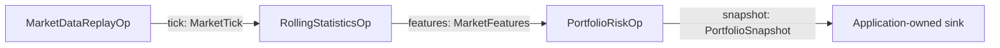

# Holoscan Finance Developer Guide

This guide describes the architecture, engineering rules, development workflow, and
release process for `holoscan-finance`. For the supported public API and a runnable
example, start with [README.md](README.md).

## Design goals

The module is intentionally small and explicit:

- Keep financial values in `decimal.Decimal`; do not silently mix binary
  floating-point arithmetic into valuation paths. Statistical returns and deviations
  are explicitly finite `float` values because their standard-library functions use
  floats.
- Exchange frozen, validated dataclasses between operators.
- Keep ingestion, feature calculation, portfolio valuation, and application-specific
  sinks separate.
- Make offline examples and unit tests deterministic and network independent.
- Follow HoloHub's module layout, metadata, CMake registration, packaging, licensing,
  and naming conventions.

This scope is deliberate. Add a dependency only when its maintenance and distribution
cost is justified by functionality that cannot reasonably be implemented with the
standard library and Holoscan.

## Architecture

The reference graph has one message type at each boundary:



State ownership is local and bounded where possible:

- `MarketDataReplayOp` owns an immutable copy of a finite input sequence and advances
  one tick per compute call.
- `RollingStatisticsOp` owns separate price and log-return windows for every observed
  symbol. Each deque is bounded by `window_size`; the number of symbols is not bounded.
- `PortfolioRiskOp` owns configured positions and the latest eligible price for each
  position symbol. Its state is bounded by the number of configured positions.
- The example's `ConsoleRiskSinkOp` belongs to the application, not the reusable
  package. Production applications should supply their own alerting, storage, or
  observability sink.

Operators exchange in-process Python objects. Do not assume that a frozen dataclass is
automatically serializable by a distributed scheduler. A cross-process deployment must
define a versioned wire schema, decimal representation, timestamp convention, and
compatibility policy explicitly.

## Repository layout

```text
holoscan-finance/
├── holohub                              # Repository-local holoscan-cli wrapper
├── Dockerfile                           # Holoscan SDK development image
├── CMakeLists.txt                       # Root project and build options
├── metadata.json                        # urn:holohub:module:v2 descriptor
├── pyproject.toml                       # Wheel metadata and Python tooling
├── applications/
│   ├── CMakeLists.txt
│   └── intraday_risk_pipeline/
│       ├── CMakeLists.txt
│       ├── data/synthetic_market_data.csv
│       └── python/
│           ├── CMakeLists.txt
│           ├── intraday_risk_pipeline.py
│           └── metadata.json
├── operators/
│   ├── CMakeLists.txt
│   ├── market_data_replay_op/
│   ├── portfolio_risk_op/
│   └── rolling_statistics_op/
├── python/holoscan/finance/
│   ├── __init__.py                      # Supported public exports
│   ├── io.py                            # Canonical CSV loader
│   ├── models.py                        # Immutable messages and validation
│   └── py.typed                         # PEP 561 type-information marker
├── tests/python/
└── pkg/holoscan-finance/                # Debian package configuration
```

Every operator and application directory contains its own `metadata.json` and
`CMakeLists.txt`. The root helpers expose them as `OP_*`, `APP_*`, and `PKG_*` CMake
options, matching the external Holoscan Module template.

## Public contracts

### Models

`python/holoscan/finance/models.py` owns all messages shared between operators. Models
must remain:

- frozen dataclasses;
- validated at construction time;
- free of mutable collection fields;
- independent of Holoscan runtime classes; and
- importable on a CPU-only host with no active graph.

The supported public contracts are:

| Model | Stable fields |
| --- | --- |
| `MarketTick` | `timestamp`, `sequence`, `symbol`, `price`, `currency` |
| `MarketFeatures` | `tick`, `simple_return`, `log_return`, `moving_average`, `return_deviation`, `price_observations`, `return_observations` |
| `Position` | `symbol`, `quantity`, `average_price`, `currency` |
| `PositionMark` | `position`, `market_price`, `market_value`, `unrealized_pnl` |
| `RiskLimits` | `max_gross_exposure`, `max_abs_net_exposure`, `max_unrealized_loss` |
| `RiskBreach` | `code`, `observed`, `limit`, `message` |
| `PortfolioSnapshot` | `timestamp`, `sequence`, `currency`, `marks`, `gross_exposure`, `net_exposure`, `unrealized_pnl`, `unpriced_symbols`, `breaches`; derived property `complete` |

Changing a field name, type, default, validation rule, or calculation is an API change.
Update models, operator tests, loader tests, the example, public exports, and user
documentation together. Prefer adding a new optional field with a safe default over
changing the meaning of an existing field, but do not use defaults to conceal missing
financial data.

### Numeric conventions

- Parse external numeric text directly into `Decimal`.
- Reject booleans, NaN, and infinite values even where Python would otherwise accept
  them as numbers.
- Require positive market prices and average prices.
- Use the sign of `Position.quantity` to distinguish long and short positions; zero is
  not a position.
- Compute market value as `quantity * market_price`.
- Compute unrealized P&L as `quantity * (market_price - average_price)` so long and
  short positions share one formula.
- Compute gross exposure as the sum of absolute market values and net exposure as the
  signed sum.
- Compare `abs(net_exposure)` with `max_abs_net_exposure`.
- Treat `max_unrealized_loss` as a positive loss allowance; a breach occurs when the
  portfolio's negative unrealized P&L exceeds that allowance.

Simple returns, log returns, and sample return deviation are finite `float` values. This
conversion is localized to `RollingStatisticsOp`; never feed those floats back into
position marking or exposure calculations.

Do not round inside the reusable operators unless a contract explicitly requires it.
Display, currency-minor-unit, and venue-specific rounding belong at an application
boundary.

### Time, ordering, and currency

`MarketTick.timestamp` must be timezone-aware and is normalized to UTC. A replay stream
requires globally strictly increasing sequences and non-decreasing timestamps. The
operators preserve source timestamps and sequences; they do not replace them with
processing time. Replay preserves the supplied order and does not use timestamps to
sleep or reorder observations.

The rolling operator's state is isolated by symbol. It calculates returns only between
consecutive observations for the same symbol, even when the input stream interleaves
symbols. Both rolling statistics and portfolio marking enforce global sequence and
timestamp monotonicity so replayed or late messages cannot regress state.

Portfolio valuation is single-currency. Position and tick currencies must agree with
the portfolio currency. Do not add an implicit `1:1` conversion or quietly drop
incompatible observations. Multi-currency support requires an explicit FX data model,
conversion timestamp policy, and tests.

### Statistical semantics

`RollingStatisticsOp` emits one features message per tick, including during warm-up. Its
rolling state includes at most `window_size` prices and `window_size` consecutive log
returns. Simple and log return are unavailable only for the first observation of a
symbol. Moving average becomes available after `min_periods` prices; sample return
deviation becomes available after `min_periods` log returns. The message reports the
actual price and return observation counts so downstream consumers do not infer a full
window prematurely.

The calculations are descriptive, backward-looking window statistics. In particular,
`return_deviation` is not annualized volatility, VaR, expected shortfall, or a model
forecast. If a new risk measure is added, name its estimator, sampling convention,
horizon, scaling, confidence level, and insufficient-data behavior in both code and
tests.

### Risk snapshot semantics

`PortfolioRiskOp` consumes per-symbol features asynchronously and retains the latest
price seen for each configured position. A snapshot can therefore combine marks from
different event times. Until every position has a mark, the operator includes its
symbols in `unpriced_symbols` and `snapshot.complete` is false.

Limits are evaluated on each complete snapshot; partial snapshots contain no breaches.
The comparison is strict, so a value equal to its limit is allowed. Breaches are normal
domain output, not exceptions: append immutable `RiskBreach` values to the snapshot.
Exceptions are reserved for invalid configuration or messages that violate the
contract.

There is currently no mark staleness threshold or market-data synchronization barrier.
Any implementation of those features must make clock choice, cutoff inclusivity, late
data, and missing-data behavior explicit.

## Development environment

The recommended environment is the repository's Holoscan SDK container. The `holohub`
wrapper bootstraps a compatible `holoscan-cli`, applies this module's Docker and build
defaults, and mounts the source tree.

Launch the development environment with:

```bash
./holohub run-container
```

The first wrapper invocation can install `holoscan-cli` and therefore requires package
index access. Override `HOLOSCAN_CLI_INSTALL_ARGS` to pin another package specification,
or set `HOLOSCAN_CLI_SOURCE` to a local CLI checkout.

## Build workflow

### Build the reference application

```bash
./holohub build intraday_risk_pipeline
```

`BUILD_ALL` defaults to `ON` for a standalone build and `OFF` when this project is nested
under a parent CMake project. `FINANCE_BUILD_TESTING` follows the same standalone-on,
nested-off policy.

### Selective CMake builds

Build everything directly:

```bash
cmake -S . -B build -DBUILD_ALL=ON -DFINANCE_BUILD_TESTING=ON
cmake --build build --parallel
```

Build only one operator or the reference application:

```bash
cmake -S . -B build-replay \
    -DBUILD_ALL=OFF \
    -DOP_market_data_replay_op=ON \
    -DFINANCE_BUILD_TESTING=OFF
cmake --build build-replay --parallel

cmake -S . -B build-app \
    -DBUILD_ALL=OFF \
    -DAPP_intraday_risk_pipeline=ON \
    -DFINANCE_BUILD_TESTING=ON
cmake --build build-app --parallel
```

Application dependency registration enables its three operators automatically. Python
sources are copied into `build/python/lib/holoscan/finance`.

Do not delete `build/`, `data/`, or `install/` directories without explicit maintainer
approval. Use a new build directory when testing a clean configuration.

## Test workflow

Run the repository test command:

```bash
./holohub test
```

For a configured local build:

```bash
ctest --test-dir build --output-on-failure
PYTHONPATH=build/python/lib${PYTHONPATH:+:$PYTHONPATH} \
    FINANCE_BUILD_DIR=build \
    python3 -m pytest tests/python -v
```

The test suite should cover four layers:

1. Model construction, immutability, boundary values, invalid types, NaN/infinity, and
   tuple normalization.
2. CSV headers, row-level diagnostics, timestamp parsing, exact decimal parsing, and
   file order.
3. Operator setup, parameter validation, per-symbol state, finite replay, long/short
   valuation, incomplete books, and every limit boundary.
4. The application graph, deterministic snapshot sequence, and expected breaches from
   the checked-in synthetic fixture.

Use small hand-calculated inputs. Assert `Decimal` values exactly. Do not add tests that
depend on live prices, network availability, wall-clock dates, or unordered collection
iteration.

When the Holoscan SDK is unavailable, unit tests install a small test-only compatibility
stub; the SDK-gated application-run test is reported as skipped. In a development
container that test should run against the real SDK. Pytest exit code 5 remains a test
failure so collection problems cannot be hidden as a successful CTest run.

## Lint and pre-commit checks

The repository uses Ruff, Ruff format, codespell, markdownlint, metadata validation,
CMake linting, and copyright checks through pre-commit. Before every commit, run the
required container command:

```bash
./holohub run-container -- "./holohub lint --install-dependencies; ./holohub lint"
```

Do not bypass a failing check. Keep formatting-only changes separate from behavioral
changes when practical so financial logic remains reviewable.

## Development import

After building, the wrapper can install a user-site `.pth` hook that extends the
installed `holoscan` namespace to the live build tree:

```bash
./holohub install --dev
python3 -c "import holoscan.finance; print(holoscan.finance.__file__)"
```

Rebuild after source changes; a wheel reinstall is not required. Remove the hook when
finished:

```bash
./holohub install --dev --uninstall
```

## Packaging

### HoloHub package command

Build Debian and wheel artifacts together:

```bash
./holohub package holoscan-finance --pkg-generator DEB,WHEEL
```

The wheel is produced under `build/dist/`. Debian output is produced under the module's
package build directory.

### Direct wheel build

`pyproject.toml` uses `scikit-build-core`. Its CMake arguments disable applications,
tests, and Debian packaging while enabling every reusable operator required by the
Python package.

```bash
python3 -m pip install build
python3 -m build --wheel
```

The wheel uses a namespace package layout and must install into
`holoscan/finance`, alongside an independently installed Holoscan SDK. Keep these values
synchronized for a release:

| Source | Value |
| --- | --- |
| `project(... VERSION ...)` in `CMakeLists.txt` | Module version |
| `[project].version` in `pyproject.toml` | Wheel version |
| `module.version` in root `metadata.json` | Module descriptor version |
| `application.version` and operator versions | Component versions |
| `holohub_configure_deb(VERSION ...)` | Derived from the CMake project version |

The wheel does not declare Holoscan as a Python runtime dependency because it cannot
choose a consumer's CUDA-compatible SDK build. Document and validate the supported SDK
version instead.

## Extending the module

### Add or change a model

1. Define the frozen dataclass and validation in `models.py`.
2. Use immutable nested values and tuples.
3. Export it from `python/holoscan/finance/__init__.py` if it is public.
4. Add boundary and immutability tests before using it in an operator.
5. Document its semantics, units, optional values, and versioning impact.

### Add an operator

1. Use a `snake_case_op` directory and a `TitleCaseOp` class name.
2. Keep Holoscan lifecycle methods thin; put independently testable calculations in
   private, side-effect-free helpers where appropriate.
3. Declare every input, output, and parameter in the class docstring and metadata.
4. Validate constructor configuration before processing messages.
5. Add its local `CMakeLists.txt` and `metadata.json`.
6. Register it in `operators/CMakeLists.txt`, package dependencies, root metadata, and
   wheel CMake arguments as required.
7. Re-export the class from `holoscan.finance` and add tests and documentation.

### Add an application

1. Put it under `applications/<application_name>/python/` with local metadata and CMake
   staging rules.
2. Keep fixtures under the application directory so source-tree and staged builds use
   identical relative paths.
3. Register exact operator dependencies in `applications/CMakeLists.txt`.
4. Make the default mode deterministic and runnable without private services.
5. Add an integration test for graph wiring and termination.

Ask maintainers before changing a `metadata.json` schema, a shared Dockerfile, or CMake
registration macros such as `add_holohub_application` and `add_holohub_operator`. Those
changes affect module tooling and downstream consumers beyond one component.

## Review checklist

For any behavioral change, reviewers should be able to answer:

- What input contract changed, and how does invalid data fail?
- Are numeric types, units, signs, rounding, and boundary comparisons explicit?
- Does state grow without a bound? If so, is the operational limit documented?
- What happens for the first observation, missing symbols, interleaved symbols, late
  data, and duplicate data?
- Are long and short positions both tested?
- Are the graph's port names consistent across code, metadata, CMake dependencies, and
  docs?
- Does the change preserve deterministic offline tests?
- Does it require serialization, persistence, external credentials, or a new runtime
  dependency?

## Release checklist

1. Confirm no template placeholders remain in metadata or documentation, and add the
   canonical `source_repository` URL after the remote repository exists.
2. Synchronize module, application, operator, wheel, and Debian versions.
3. Verify the minimum and tested Holoscan SDK versions.
4. Configure and build from a new build directory without deleting existing build
   outputs.
5. Run unit and integration tests on every supported Python/platform combination
   available to CI.
6. Run the required lint command in the development container.
7. Run `intraday_risk_pipeline` and compare its deterministic breach sequence with the
   application test.
8. Build `DEB,WHEEL`, inspect their contents, and install the wheel into a clean
   environment containing the supported Holoscan SDK.
9. Smoke-test `from holoscan.finance import MarketDataReplayOp` from outside the source
   tree.
10. Review the README's limitations and package installation instructions for the
    release.

## Known limitations

The current module intentionally omits annualized volatility and VaR; synchronized or
staleness-aware portfolio marks; FX conversion; corrections, exchange calendars, and
corporate actions; durable/checkpointed state; and a distributed serialization layer.
See [Scope and limitations](README.md#scope-and-limitations) for the complete consumer
warning. New work in any of these areas needs an explicit domain contract before code is
added.

## Further reading

- [HoloHub modules guide](https://github.com/nvidia-holoscan/holohub/tree/main/modules)
- [HoloHub contribution guide](https://github.com/nvidia-holoscan/holohub/blob/main/CONTRIBUTING.md)
- [Holoscan SDK User Guide](https://docs.nvidia.com/holoscan/sdk-user-guide/introduction/overview)
- [Create a Holoscan Module tutorial](https://github.com/nvidia-holoscan/holohub/tree/main/tutorials/holoscan-modules/create-a-module)
