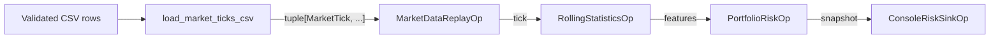

# Holoscan for Financial Services Industry

`holoscan-finance` is a self-contained
[Holoscan Module](https://github.com/nvidia-holoscan/holohub/tree/main/modules) for
building streaming financial-services applications. It provides immutable market and
portfolio messages, deterministic CSV replay, per-symbol rolling statistics, and
portfolio-limit evaluation under the `holoscan.finance` namespace.

> [!IMPORTANT]
> This project is a technical reference implementation. It is not investment, trading,
> accounting, regulatory, or risk-management advice, and it is not a production risk
> engine. Validate the calculations, controls, and data sources for your use case.

## What is included

| Component | Purpose |
| --- | --- |
| `MarketDataReplayOp` | Emit a finite, validated sequence of market ticks in deterministic order. |
| `RollingStatisticsOp` | Maintain independent per-symbol windows and emit returns, a moving average, and return deviation. |
| `PortfolioRiskOp` | Mark configured long and short positions with the latest observed prices and evaluate portfolio limits. |
| Immutable data models | Define explicit contracts for ticks, features, positions, marks, breaches, and snapshots. |
| `load_market_ticks_csv` | Load the module's canonical CSV market-data format using the standard library. |
| `intraday_risk_pipeline` | Demonstrate an end-to-end offline replay with checked-in synthetic data. |

## Requirements

| Requirement | Supported version |
| --- | --- |
| Holoscan SDK | 4.3.0 or later |
| Python | 3.10 through 3.13 |
| Holoscan CLI (`./holohub`) | `holoscan-cli` 5.0.0 or later, on Python 3.11 through 3.14 |
| CMake | 3.24 or later |
| Platform | `x86_64` or `aarch64` |

Install the Holoscan SDK separately using the package and CUDA variant appropriate for
the target system. The `holoscan-finance` wheel deliberately does not select a Holoscan
or CUDA build on the consumer's behalf.

## Quick start

From the repository root, run the reference application:

```bash
./holohub run intraday_risk_pipeline
```

The application replays
`applications/intraday_risk_pipeline/data/synthetic_market_data.csv`, calculates a
three-observation rolling window, marks a small long/short portfolio, and logs every
partial or complete snapshot and limit breach. It is finite and requires no network
access or external market-data service.

## Pipeline flow



`RollingStatisticsOp` owns one bounded history per symbol. `PortfolioRiskOp` owns the
latest mark per configured symbol and emits a new portfolio view whenever it receives
features. These stateful operators are intentionally independent so applications can
replace replay, persistence, alerting, or execution components without changing the
financial message contracts.

## Python API

The public API is exported from `holoscan.finance`:

```python
from decimal import Decimal

from holoscan.core import Application
from holoscan.finance import (
    MarketDataReplayOp,
    PortfolioRiskOp,
    Position,
    RiskLimits,
    RollingStatisticsOp,
    load_market_ticks_csv,
)


class RiskApplication(Application):
    def compose(self) -> None:
        ticks = load_market_ticks_csv("market_ticks.csv")

        replay = MarketDataReplayOp(self, ticks=ticks, name="market_data_replay")
        statistics = RollingStatisticsOp(
            self,
            window_size=20,
            min_periods=5,
            name="rolling_statistics",
        )
        risk = PortfolioRiskOp(
            self,
            positions=(
                Position(
                    symbol="NVDA",
                    quantity=Decimal("100"),
                    average_price=Decimal("150.00"),
                ),
            ),
            limits=RiskLimits(
                max_gross_exposure=Decimal("25000"),
                max_abs_net_exposure=Decimal("25000"),
                max_unrealized_loss=Decimal("1000"),
            ),
            name="portfolio_risk",
        )

        self.add_flow(replay, statistics, {("tick", "tick")})
        self.add_flow(statistics, risk, {("features", "features")})
        # Connect risk's "snapshot" output to an application-specific sink.
```

Prices, quantities, position values, exposures, and P&L use `decimal.Decimal`.
Construct them from strings when exact decimal input matters; avoid constructing them
from binary floating-point values. Simple returns, log returns, and return deviation are
finite Python `float` values because the standard-library logarithm and statistics
functions operate on floats.

### Data models

Every public model is a frozen dataclass. Instances can be passed safely between
operators without defensive copying, and tuple-valued collections cannot be mutated by
downstream consumers.

| Model | Fields | Contract |
| --- | --- | --- |
| `MarketTick` | `timestamp`, `sequence`, `symbol`, `price`, `currency="USD"` | One positive-price observation. `timestamp` must be timezone-aware and is normalized to UTC; `sequence` is a non-negative integer; symbols and currencies are normalized to uppercase. |
| `MarketFeatures` | `tick`, `simple_return`, `log_return`, `moving_average`, `return_deviation`, `price_observations`, `return_observations` | The original tick plus the state of that symbol's current rolling window. Simple/log returns are `float` values after the first symbol observation; moving average is a `Decimal`; warm-up values may be `None`. |
| `Position` | `symbol`, `quantity`, `average_price`, `currency="USD"` | A non-zero signed quantity and positive average entry price. Positive quantities are long; negative quantities are short. |
| `PositionMark` | `position`, `market_price`, `market_value`, `unrealized_pnl` | A configured position valued with the latest available price for its symbol. |
| `RiskLimits` | `max_gross_exposure`, `max_abs_net_exposure`, `max_unrealized_loss` | Independently optional positive limits. `None` disables a limit. |
| `RiskBreach` | `code`, `observed`, `limit`, `message` | A machine-readable breach code plus the observed value, threshold, and human-readable explanation. |
| `PortfolioSnapshot` | `timestamp`, `sequence`, `currency`, `marks`, `gross_exposure`, `net_exposure`, `unrealized_pnl`, `unpriced_symbols`, `breaches` | An immutable portfolio view as of the tick that triggered it. The `complete` property is true when `unpriced_symbols` is empty. |

Validation occurs when a model is constructed. Invalid timestamps, identifiers,
currencies, non-finite values, impossible prices, zero positions, and non-positive risk
limits fail early with `TypeError` or `ValueError` instead of entering the graph.

### CSV data contract

`load_market_ticks_csv(path)` reads a header-based UTF-8 CSV file and returns validated
ticks in file order. The required schema is:

| Column | Value |
| --- | --- |
| `timestamp` | ISO 8601 timestamp with a UTC offset, for example `2026-01-05T14:30:00+00:00`; `Z` is also accepted. |
| `sequence` | Non-negative integer identifying the observation's source order. Sequences must be strictly increasing. |
| `symbol` | Non-empty instrument identifier. |
| `price` | Positive finite decimal value. |
| `currency` | Three-letter currency code normalized to uppercase, such as `usd` becoming `USD`. |

Example:

```csv
timestamp,sequence,symbol,price,currency
2026-01-05T14:30:00+00:00,1,ALPHA,100.00,USD
2026-01-05T14:30:01+00:00,2,BETA,200.00,USD
```

The loader requires all five named columns, ignores additional columns, normalizes
timestamps to UTC, and requires non-decreasing timestamps across the file. Empty files,
malformed rows, non-increasing sequences, and time regressions are reported at the
ingestion boundary. Normalize vendor-specific feeds into this contract before creating
the application graph.

### Operators

#### `MarketDataReplayOp`

| Direction | Port | Message |
| --- | --- | --- |
| Output | `tick` | `MarketTick` |

| Parameter | Meaning |
| --- | --- |
| `ticks` | Finite sequence of validated `MarketTick` objects, emitted once in the supplied order. |
| `name` | Holoscan operator name; defaults to `market_data_replay`. |

Replay is deterministic and unpaced. Source timestamps remain data; the operator does
not sleep to reproduce wall-clock timing. It installs a Holoscan `CountCondition` for
the number of records; callers may supply additional scheduling conditions positionally.
The `record_count` property reports the immutable replay size.

#### `RollingStatisticsOp`

| Direction | Port | Message |
| --- | --- | --- |
| Input | `tick` | `MarketTick` |
| Output | `features` | `MarketFeatures` |

| Parameter | Meaning |
| --- | --- |
| `window_size` | Maximum number of price and return observations retained independently for each symbol; integer at least 2, default `20`. |
| `min_periods` | Warm-up count used independently for moving average prices and return deviation; integer from 2 through `window_size`, default `window_size`. |
| `name` | Holoscan operator name; defaults to `rolling_statistics`. |

The operator emits one features message for every tick. It computes consecutive simple
and logarithmic returns after the first observation for a symbol. `moving_average`
becomes available after `min_periods` price observations; `return_deviation` becomes
available after `min_periods` log-return observations and uses the sample standard
deviation. The deviation is a descriptive window statistic; it is not annualized
volatility or Value at Risk (VaR). Duplicate sequences, global timestamp regressions,
and currency changes for an existing symbol are rejected before state is updated.

#### `PortfolioRiskOp`

| Direction | Port | Message |
| --- | --- | --- |
| Input | `features` | `MarketFeatures` |
| Output | `snapshot` | `PortfolioSnapshot` |

| Parameter | Meaning |
| --- | --- |
| `positions` | Non-empty sequence of unique-symbol `Position` objects. |
| `limits` | Optional `RiskLimits`; `None` disables all limits. Limits are evaluated only for complete snapshots. |
| `name` | Holoscan operator name; defaults to `portfolio_risk`. |

The operator maintains the latest price received for every configured symbol. It emits
a snapshot after each features message, including partial snapshots while one or more
positions remain unpriced. Gross exposure is the sum of absolute market values; net
exposure is their signed sum; unrealized P&L is the sum of position-level unrealized
P&L. Partial snapshots have no breaches because limits are evaluated only after every
position is priced. Equal-to-limit values are allowed; only a strict exceedance creates
a `RiskBreach`. Breaches are emitted as data in `snapshot.breaches` rather than raised
as runtime errors. Duplicate or late feature messages are rejected so an older mark
cannot silently replace a newer one.

## Build, test, and install

The repository-local `holohub` wrapper supplies the module defaults expected by the
HoloHub CLI.

### Container build

```bash
./holohub build intraday_risk_pipeline
```

### Local CMake build

Use an environment where the Holoscan SDK is already importable:

```bash
cmake -S . -B build -DBUILD_ALL=ON -DFINANCE_BUILD_TESTING=ON
cmake --build build --parallel
```

CMake stages the namespace package at `build/python/lib/holoscan/finance` and the
application under the build tree.

### Tests

```bash
./holohub test
```

Without the wrapper:

```bash
ctest --test-dir build --output-on-failure
PYTHONPATH=build/python/lib${PYTHONPATH:+:$PYTHONPATH} \
    FINANCE_BUILD_DIR=build \
    python3 -m pytest tests/python -v
```

The conditional `PYTHONPATH` append preserves an existing Holoscan SDK path without
introducing an empty path entry when the variable is unset.

Before committing, run the repository's required lint gate:

```bash
./holohub run-container -- "./holohub lint --install-dependencies; ./holohub lint"
```

### Development install

After building, install a user-site development hook that points to the live build
tree:

```bash
./holohub install --dev
```

Remove it when it is no longer needed:

```bash
./holohub install --dev --uninstall
```

### Packages

Build both supported package formats:

```bash
./holohub package holoscan-finance --pkg-generator DEB,WHEEL
```

Wheel artifacts are written under `build/dist/`; Debian artifacts are written under
the package build directory. A wheel can also be built directly:

```bash
python3 -m pip install build
python3 -m build --wheel
```

Install the correct Holoscan SDK distribution first, then install the generated
`holoscan_finance-*.whl`. See [DEVELOPER.md](DEVELOPER.md) for selective CMake options,
packaging invariants, and the release checklist.

## Project layout

```text
holoscan-finance/
├── applications/
│   └── intraday_risk_pipeline/
│       ├── data/synthetic_market_data.csv
│       └── python/intraday_risk_pipeline.py
├── operators/
│   ├── market_data_replay_op/
│   ├── portfolio_risk_op/
│   └── rolling_statistics_op/
├── python/holoscan/finance/
│   ├── __init__.py
│   ├── io.py
│   ├── models.py
│   └── py.typed
├── tests/python/
├── pkg/holoscan-finance/
├── CMakeLists.txt
├── metadata.json
└── pyproject.toml
```

Each application and operator has its own `metadata.json` and `CMakeLists.txt`, as
required by the HoloHub module conventions. The top-level package re-exports the
supported public API; consumers should import from `holoscan.finance` rather than from
operator source directories.

## Scope and limitations

- This is a reference implementation, not investment advice or a production control.
- `return_deviation` is a rolling descriptive deviation. It is not annualized
  volatility, VaR, expected shortfall, or a forecast.
- Portfolio marks are the latest asynchronously observed prices. The module has no
  staleness threshold, synchronized market-data barrier, or consolidated snapshot time.
- A portfolio uses one currency. The module performs no foreign-exchange conversion,
  hedging, or cross-currency aggregation.
- Replay assumes already normalized observations. It does not apply corrections,
  exchange calendars, session boundaries, splits, dividends, or other corporate
  actions.
- Operator state is held in memory. There is no checkpointing, recovery, durable event
  log, or exactly-once processing guarantee.
- Messages are in-process Python objects. Distributed or cross-process graphs require an
  explicit, versioned serialization and transport layer.

## License

Apache-2.0. See [LICENSE](LICENSE).

## Further reading

- [Holoscan SDK User Guide](https://docs.nvidia.com/holoscan/sdk-user-guide/introduction/overview)
- [HoloHub contribution guide](https://github.com/nvidia-holoscan/holohub/blob/main/CONTRIBUTING.md)
- [Create a Holoscan Module](https://github.com/nvidia-holoscan/holohub/tree/main/tutorials/holoscan-modules/create-a-module)
