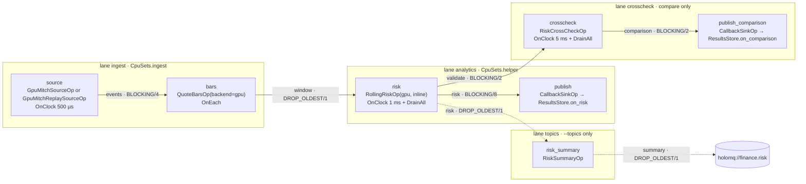
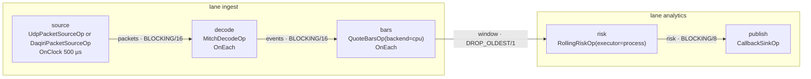
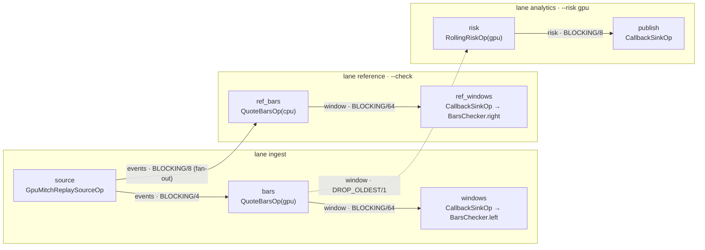

# Architecture

How the two applications are put together on Holoscan SDK 5: the graphs, the lanes they
run on, what flows between operators, how the dashboard reaches the data plane, and the
performance invariants the layout protects. The operator reference is the
[catalog](../operators/README.md); what changed from Holoscan 4.3 is in
[PORTING_TO_5_0.md](PORTING_TO_5_0.md).

## Layers

| Layer | Where | Imports |
| --- | --- | --- |
| Applications | `applications/<app>/<app>.py`: `compose()`, `rules()` and a short `main()` | `holoscan`, `holoscan_finance` |
| Shared app plumbing | `holoscan_finance.app` (CLI, CPU sets and lanes, contexts, runner, plan rules), `holoscan_finance.dashboard` | `holoscan` only inside functions; FastAPI in the server |
| Operators | `holoscan_finance.operators`: ten thin adapters (ports, `Param`s, contract, lifecycle) | `holoscan` |
| Library | `marketdata`, `nyq`, `ingest`, `analytics`, `telemetry`, `control`, `validation`, `tools` | NumPy; CuPy, SciPy, DuckDB and the rest only inside functions |

Each operator wraps a library *processor* that holds the logic and is tested without
Holoscan: `GpuIngest` (both GPU sources), `UdpReceiver`, `DaqiriHostReceiver`,
`HostMitchDecoder`, `BarBuilder`, `RollingRisk` and `CpuCrossCheck`. Nothing below the
operator layer imports the SDK, so the CPU tools, the feed containers, spawned analytics
workers and the pure test tier run without a GPU driver (in 5.0, `import holoscan` links
libcuda). `tests/python/packaging/test_import_hygiene.py` enforces this.

The package `holoscan_finance` is published by Holoscan as `holoscan.finance` through a
`holoscan.modules` entry point (wheel, CMake build tree, or `holoscan_finance.devpath`).
Inside the package, modules import each other relatively; applications and tests import
the canonical name.

## Graphs and lanes

A lane is an authored partition: one runtime thread with its own CPU placement. Every
operator is in an authored lane, so the compiler never adds an automatic partition. Edge
labels are `port · policy/depth`.

### `equity_analytics`, GPU front ends (`gpudirect`, `replay`)

Decode is fused into the GPU sources: a ring slot stays leased until decode has
synchronized, so the lease has exactly one consumer by construction and no extra hop. Bars
share the source's lane, so the per-packet path never crosses a thread; the only
cross-lane edge on the data path is the latest-only window edge, used once per closed bar.

### `equity_analytics`, host front ends (`udp`, `daqiri-host`)

The `crosscheck` and `topics` lanes are the same as above. On host front ends the analytics
run in spawned worker processes (`gpu_window`, `cpu_window`): Python decode keeps the GIL
busy, and running SciPy or the GPU engine in the same process measurably slows both.

### `market_data_bench`

With `--check`, one decoded stream feeds two backends of the same operator class. The
source retries a fan-out emit until both consumers accept it, so neither branch loses a
batch, and every GPU window is compared with its CPU twin by
`(generation, completed_bars)`. After the run, an independent host decode of the pcap
(`validation.HostReference`) is compared with every closed bar.

### The lane rule

`compose()` registers lanes through `app.placement.Lanes`, and every layout follows this
rule (checked by compiling every mode and option combination in `tests/python/graphs`):

1. Each lane is weakly connected and convex: no path leaves it and comes back.
2. Each lane has exactly one entry operator: a clock-triggered operator, or one fed only
   from other lanes or from an import topic. Every other member has at least one input
   edge from inside the lane; extra inputs from other lanes are fine.
3. `partition(name)` is called once per name, and every operator is authored, so there is
   never an automatic partition.

A second entry operator gives `PARTITION_COVER_INVALID`; a non-convex layout cannot
compile either. This is why a sink fed only from another lane gets its own lane, and why
`publish` lives with `risk` rather than in a lane of its own.

### Placement

`app.runner.prepare_process()` computes `CpuSets` once, before the graph runs:

| Set | Value |
| --- | --- |
| `all` | the process affinity at start-up |
| `reserved` | the DPDK lcores (`--nic-master-core`, `--nic-rx-core`) in DAQIRI modes, else none |
| `app` | `all − reserved`; every pipeline thread |
| `ingest` | `--ingest-cpus`, else `app`; the `ingest` lane's `ThreadPlacement` (with `BUSY_POLL` only under `--ingest-busy-poll`) |
| `helper` | `app`, minus `ingest` only when a busy-polled ingest set is carved out; every other lane, the drain and receiver threads. The main thread is masked to it before `run_async` (and earlier threads are swept off `all − helper`), so everything created later inherits it: uvicorn, the stall heartbeat, CuPy and the runtime's own threads |
| `worker` | `helper`; spawned analytics workers pin themselves to it (the 4.3 BLAS candidate set) |

The runtime never re-applies a lane's placement, so a mask change made in `start()` would
persist. `daqiri_init` therefore runs inside `thread_mask(...)`, which saves the lane's
mask, widens it for the call, and restores and asserts it afterwards (DPDK's EAL pins its
caller). Drain and receiver threads are started under `helper_mask(...)`: the process
mask, never the lane's. The plan rule `lanes_avoid_cpus(reserved)` checks the result.

## Payloads

Every port is a `pyobject` port except the holomq summary. Payloads are immutable after
`emit()`; consumers copy before modifying. Every GPU operator uses the CUDA legacy default
stream; producers synchronize before they publish, and no payload carries a CUDA event.

| Payload | Producer → consumer | Memory |
| --- | --- | --- |
| `PacketBatch` (datagrams, receive times, wire counts, peers) | host sources → `MitchDecodeOp` | host; the receiver hands the bytes over |
| `list[ReplayBatch]` (the 4.3 record batch, one per packet) | `MitchDecodeOp` → `QuoteBarsOp(cpu)` | host |
| `list[GpuReplayBatch]` (the 4.3 device columns, one element) | GPU sources → `QuoteBarsOp(gpu)`, and `QuoteBarsOp(cpu)` in the bench reference lane | device columns from CuPy's pool; complete before emit; never aliases ring slots |
| `BarWindow` (per-bar return vectors, bar times, generation, completed bars, receive stamp) | `QuoteBarsOp` → `RollingRiskOp` (latest only), `CallbackSinkOp` | NumPy or CuPy parts; closed bars are never mutated; `rows` is stacked only by the consumer, so a skipped window costs no GPU work |
| `RiskUpdate` (window, result dict, host rows when validated) | `RollingRiskOp` → `CallbackSinkOp`, `RiskCrossCheckOp`, `RiskSummaryOp` | host results |
| `RiskComparison` (GPU update, CPU result, agreement, matched work) | `RiskCrossCheckOp` → `CallbackSinkOp` | host |
| `holoscan.schema.String` (JSON ≤ 480 B) | `RiskSummaryOp` → `export_topic` | host; crosses processes |

The decoded record layouts (`ReplayBatch`, `GpuReplayBatch`) are the 4.3 classes, kept
verbatim because the bit-identity tools compare them field by field.

## Control plane

The dashboard never sends messages into the graph. Live objects are injected into
operators as `Ref` parameters, and operators read them once per activation:

| Object | Written by | Read by |
| --- | --- | --- |
| `Knob[FeedDirectory]`: manifest, generation, sender port, universe | `ReplayDirectory.set_manifest` (HTTP `POST /manifest`, or the replay loop through `ReplayGenerations`) | decode sites and `QuoteBarsOp`, lock-free (`knob.get()`); a generation change resets the bars at the first batch decoded under it |
| `CrossCheckGate` | `RollingRiskOp` claims; `ResultsStore.on_comparison` releases after publishing | `RollingRiskOp`; `FullDayController` suspends validation during a full-day burst |
| `CaptureTap` | HTTP `POST /capture`, `/capture/finish` | the decode sites and `ResultsStore` record into it |
| `FeedControl` | HTTP `/feedrate`, `/feedstatus`, `/replay/resume` | the external sender, which polls; never the graph (replay mode ignores it) |

Results flow out through `CallbackSinkOp` into `ResultsStore` callbacks on the analytics
and crosscheck lanes. Those callbacks never raise: an exception is recorded as the run's
error, publication stops and the gate is released, as 4.3's publisher did.

Locks follow one global order: `ReplayDirectory.lock` → its listener lock →
`FullDayController` → `ResultsStore.lock` → `CaptureTap` → `IngestStats.lock`. Directory
listeners run after the directory lock is released, and every generation filter reads the
knob without a lock, so no data-plane callback can wait on an HTTP request.

## Telemetry plane

Operators write typed stats objects, one writer thread per field; the HTTP thread reads
only these host objects. No CUDA call and no data-plane lock is ever taken from HTTP.

| Object | Writer | Contents |
| --- | --- | --- |
| `IngestStats` | the source (and its drain thread for ring and arrival buckets); `MitchDecodeOp` for decode counters | packets, messages, sequence gaps, ring drops, stale and malformed packets, bursts, stalls (`burst_gaps_ms`, `native.poll_gaps_*`), replay pacing, retries, lane CPUs |
| `BarsStats` | `QuoteBarsOp` | an immutable `BarCounters` per batch (one 40-byte D2H on the GPU), a `SymbolSnapshot` at most every 250 ms, sequence and stale counters, the last window key |
| `RiskStats` | `RollingRiskOp`, `RiskCrossCheckOp`, `RiskSummaryOp` (disjoint fields) | windows received and superseded, analyses, gate waits, late activations, timings, errors |

`GET /snapshot` keeps every 4.3 key (`network.ingest` still reports `async`, `ano`, `gpu`
or `replay`) and adds `network.ingest_mode` and an `engine` block (SDK version, lanes,
edges, clocks, lane CPUs, risk and source counters). `GET /plan` returns the compiled plan
summary.

A finite run (`--exit-when-drained`, the bench) stops when `app.drained.DrainedCondition`
holds: the source reached end of stream with nothing pending, the bars saw every event
batch, risk analyzed the last window (matched by `(generation, completed_bars)`) and every
result was published. The runner then calls `session.request_stop()`, with nothing queued.
Operators never complete or stop the run themselves.

## Invariants

| # | Invariant | How the layout keeps it | Checked by |
| --- | --- | --- | --- |
| 1 | Lossless 200,000 packets/s (6.6M msgs/s) on GPUDirect | 131,072-message batches, 4,096-packet / 20 ms bursts, 114,688 NIC buffers, a 1M-slot ring, zero-copy staging, the native drain; source and bars in one lane | NIC run (with approval); NIC-free bench `paced` and `throughput` (≥ 2× line rate) |
| 2 | A GIL-free native drain | `daqiri_drain.cpp` byte-identical to 4.3, built before `daqiri_init`; ring rows released only after decode synchronized, in order; bursts never wrap | `library/test_gpu_ingest_pull.py`, `gpu/test_gpu_ingest.py`, `library/test_kernel_sources_verbatim.py` |
| 3 | No market data on the CPU in GPU mode | only headers, counters, a 250 ms symbol snapshot and results cross to the host; GPU front ends with CPU analytics are rejected | `app/test_cli.py`, `operators/test_quote_bars_op.py` |
| 4 | Latest-only windows; bars never block; bounded analysis rate | `DROP_OLDEST/1` window edge; a one-window slot polled every 1 ms with the minimum interval enforced in the operator | plan rules; `graphs/test_latest_only.py`; `graphs/test_risk_pickup_latency.py` |
| 5 | GPU decode and bars bit-identical to the CPU | kernels, flags and the 4.3 bar and record classes verbatim; one host copy of the sequence rules | `gpu/*`; `gpu_validate`; bench `--check` |
| 6 | Generation, sequence and stale semantics | decode reads the directory immediately before decoding; bars reset on a new generation; replay loops register fresh ports | `library/test_sequence.py`, `test_accounting.py`, `control/test_directory.py` |
| 7 | Statistics conventions | `CovarianceEngine`, agreement tolerances and eligibility unchanged | `library/test_covariance.py`, `test_agreement.py` |
| 8 | Warm-up before data | kernels and worker pools start in `start()`, which runs downstream first and before any `compute`; the NIC starts last | operator tests |
| 9 | BLAS tuning on the 4.3 core set | workers pinned to `CpuSets.worker` | `library/test_workers.py` |
| 10 | Core and IRQ isolation | main thread masked to `helper` (`app` unless a busy-polled ingest set is carved out); lanes placed; `daqiri_init` mask restored and asserted; the post-init sweep; helpers under the process mask | plan rule `lanes_avoid_cpus`; `library/test_affinity.py`; `app/test_runner.py`; source operator tests |
| 11 | Interpreter tuning | `sys.setswitchinterval(0.001)`; no idle sleeps in `compute`; no clock below 500 µs by default | `app/test_runner.py` |
| 12 | Latency accounting | the receive stamp of the packet that closed the newest bar travels in `BarWindow.recv_ns`; results publish on the risk lane right after analysis | `control/test_results_store.py`; e2e reports |
| 13 | No allocations that wake a suspended iGPU | ring, pinned buffers and replay frames preallocated in `start()` | review; NIC run |

## Adding an operator

1. Put the logic in a library class under `holoscan_finance` that imports no Holoscan and
   test it there.
2. Write the adapter in `python/holoscan_finance/operators/<module>.py`: class-level
   `hs.Input`/`hs.Output`/`hs.Param`, an `__init__` with no arguments, and port names equal
   to the attribute names. Validate parameters in `setup()` (it must not touch a device or
   a file); declare optional ports only when their bool `Param` is set; create run
   resources in `start()` and release them in `stop()`, which must tolerate a partial
   `start()`. Take live objects as `Ref` parameters, and fall back to a private stats
   object when none is given. Use `operators._common.PendingEmits` for any output that
   may meet a full `BLOCKING` edge it cannot rely on being drained in its own lane.
3. Register the class in `operators/__init__.py` and `holoscan_finance/__init__.py`, add the
   catalog entry `operators/<snake>_op/` (`metadata.json` with `urn:holoscan:operator:v1`
   and a README), and list it in the root `metadata.json` (`subprojects`,
   `operator_names`). `tests/python/packaging/test_metadata.py` checks that these agree.
4. Test it with `holoscan.testing.OperatorTestHarness` in
   `tests/python/operators/test_<module>.py`: stage every declared input, run sources with
   `run_async` and `wait_for_output`, and mark the module `sdk` (and `gpu` if it needs one).
5. In an application, put it in a lane that keeps the lane rule, set the edge policy and
   depth explicitly, and add a plan rule for any property the composition relies on.
