# GPUDirect ingest: NIC → GPU memory → GPU decode → GPU quote bars

`--ingest gpudirect` keeps market data on the GPU from the network card onward. DAQIRI
receives MITCH packets straight into GPU memory (GPUDirect RDMA over dma-buf), and CUDA
kernels gather the UDP payloads, decode MITCH and maintain the five-second quote bars. The
rolling covariance/correlation analytics then run in the receiving process on the
device-resident window (`RollingRiskOp`); the CPU comparator and the dashboard are the
same as on the host paths.

The front end is one flag on the same graph (`applications/equity_analytics`):

```bash
--ingest udp          # kernel UDP socket; Python decode
--ingest daqiri-host  # DAQIRI kernel bypass into pinned host memory; Python decode
--ingest gpudirect    # DAQIRI GPUDirect into GPU memory; CUDA gather, decode and quote bars
--ingest replay       # pcap frames staged in GPU memory, then the gpudirect chain (no NIC)
```

The GPU path is sized for 200,000 packets/s (6.6M MITCH messages/s), a full trading day
of 2.88M packets in about 14.4 s: 131,072-message batches, 4,096-packet DAQIRI bursts with
a 20 ms partial-burst timeout, 114,688 NIC buffers, a 1,048,576-slot device ring and a
receive drain in a native thread ([design parameters](#design-parameters)).

NIC-free results (2026-10-20; Holoscan SDK 5.0.0 image on IGX Thor with the RTX PRO 6000;
a full-size synthetic day of 2,880,001 packets replayed from GPU memory through the same
gather, ring, decode and bars code; [VALIDATION.md](VALIDATION.md)): **lossless and real
time at 200,000 packets/s in 3 of 3 full-day runs, 62.1M MITCH messages/s median unpaced,
and decode and bars bit-identical to the CPU implementation** (returns within 1 ULP). NIC
results of this code are not recorded yet ([status](#status)).

**Read this before attributing the gain to the GPU:** the host-decode path is limited
by interpreted Python, and a compiled CPU decoder is ~130× faster than it on one core
(36.1M vs 0.27M messages/s, `decode_bench`, 2026-10-20). See
[Is it the GPU, or is it removing Python?](#is-it-the-gpu-or-is-it-removing-python)

## Data path

```mermaid
flowchart LR
    NIC[ConnectX-7] -->|GPUDirect RDMA, dma-buf| RX[DAQIRI RX buffers in GPU memory]
    RX -->|gather_frame kernel| SL[Payload slots on GPU]
    SL -->|mitch_decode kernel, 2 passes| EV[Observation columns on GPU]
    EV -->|bars_scatter / apply / close kernels| QB[Quote bars on GPU]
    QB -->|one row per closed 5 s bar| AN[CuPy + cuBLAS rolling covariance]
    AN --> W[Dashboard]
```



| Stage | What happens | Where | Implementation |
| --- | --- | --- | --- |
| Receive | Flow-matched frames DMA'd from the NIC into a `device` memory region | NIC → GPU | DAQIRI (DPDK engine, dma-buf; no `nvidia_peermem`) |
| Frame addresses | Device address and length of every frame in a burst | CPU, native drain thread (never takes the Python lock) | [daqiri_drain.cpp](../python/holoscan_finance/ingest/native/daqiri_drain.cpp), built on first start; one host→device copy per burst |
| Gather + framing | Copy each UDP payload into a slot of a preallocated device ring (1,048,576 slots, ~5 s at 200,000 packets/s); apply the IPv4/UDP boundary checks and MITCH `inspect_unit` framing check | GPU | `gather_frame` kernel ([gpu_mitch.py](../python/holoscan_finance/marketdata/gpu_mitch.py)) |
| Receive accounting | Sequence gaps, reordering, ring capacity, per-100 ms arrival buckets from a 7-column header per packet | CPU, per burst, in the source operator's `compute()` | vectorized NumPy ([`GpuMitchSourceOp`](../operators/gpu_mitch_source_op/README.md), [accounting.py](../python/holoscan_finance/ingest/accounting.py)) |
| MITCH decode | Validate every message and write observations (quotes, trades, halts) in wire order | GPU, one thread per packet | `mitch_decode` kernel, count pass + write pass ([gpu_decoder.py](../python/holoscan_finance/marketdata/gpu_decoder.py)) |
| Quote bars | Last valid quote/trade per instrument per bar segment, volume, marks, log returns | GPU | `bars_scatter`, `bars_apply`, `bars_close` kernels ([`QuoteBarsOp`](../operators/quote_bars_op/README.md) with `backend="gpu"`, [gpu_bars.py](../python/holoscan_finance/marketdata/gpu_bars.py)) |
| Analytics | Rolling volatility, covariance, correlation and eligibility | GPU | CuPy + cuBLAS on the device-resident bar window, in the receiving process ([`RollingRiskOp`](../operators/rolling_risk_op/README.md)) |
| Scheduling, HTTP | Operator scheduling, generation/sequence checks per batch, dashboard | CPU | Holoscan, NumPy, FastAPI |

Receive, bars and analytics are the operators `GpuMitchSourceOp` →
`QuoteBarsOp(backend="gpu")` → `RollingRiskOp` ([operators](../operators/README.md)); the
application adds the MITCH-to-NYQ directory, the dashboard and the CPU cross-check
(`RiskCrossCheckOp`). Source and bars share one thread (the `ingest` lane), so the
per-packet path crosses no thread boundary; see [architecture](ARCHITECTURE.md).

**No market data is copied to or computed on the CPU in this mode**: packet payloads,
decoded observations, quote bars and the rolling return window all stay in GPU memory,
and the covariance engine consumes the window in place. What crosses to the host is
control metadata (a 7-field header per packet for loss accounting, segment boundaries,
counters) and the dashboard's compact results. Three things made that true:

- **Native drain.** DAQIRI's Python binding returns one packet address per call (~1 µs
  of Python each). A C++ thread,
  [daqiri_drain.cpp](../python/holoscan_finance/ingest/native/daqiri_drain.cpp), takes each
  burst instead: it fetches every frame's address and length, launches the gather kernel
  into a preallocated device ring, copies the per-packet header to pinned host memory and
  returns the burst to the NIC, without taking the Python interpreter lock and without
  allocating. It accepts DAQIRI's own burst objects, so it is compiled against the
  installed DAQIRI and CUDA headers into the kernel cache (~5 s once); it is built before
  the NIC is initialized. If it cannot be built, a Python drain thread does the same work
  (`HOLOSCAN_FINANCE_NATIVE_DRAIN=0` selects it; `HOLOSCAN_FINANCE_NATIVE=0` disables the
  native helper). The fallback reads each packet's address through the binding (one call
  per packet).
- **Device-resident bars.** Closed bars stay on the GPU and the window is a tuple of CuPy
  vectors, stacked only by the analytics, instead of copying each bar to the host.
- **In-process GPU analytics.** `RollingRiskOp` runs in the receiving process and accepts
  the device window directly, computing eligibility (`var`) on the GPU too. Its input
  keeps only the newest window (a `DROP_OLDEST`/1 edge into a one-window slot), so slow
  analytics skip windows instead of stalling ingest. (In `compare` mode the CPU comparator
  receives a host copy; that is validation, not the data path.)

Unlike the socket and host-memory paths, this mode uses **custom CUDA kernels**
(gather, MITCH decode, quote bars), compiled at startup with CuPy's NVRTC.
Compilation takes about 10 s once; set `CUPY_CACHE_DIR` to a persistent directory
(the Thor launcher does) and later starts load them in under a second. Warm-up runs in
the operators' `start()`, which Holoscan runs downstream first and before any packet is
accepted, so the NIC starts last.

## Correctness

The GPU code reproduces the host implementation it replaces, including every
rejection rule. [`gpu_validate`](../python/holoscan_finance/tools/gpu_validate.py) replays
a capture of the MITCH wire packets through both implementations and compares them. The
table is its result on a full-size synthetic day (2026-10-20, Holoscan SDK 5.0.0 image;
[VALIDATION.md, step 2](VALIDATION.md#2-library-bit-identity-gpu-vs-host-decode-and-bars)).

| Check | Scope | Result |
| --- | --- | --- |
| MITCH decode | 2,880,001 packets → 92,160,001 observations | **Bit-identical**: accept/reject stage, counts, sequences and every field (floats compared as raw bits) |
| MITCH decode, mutated packets | 240,000 packets: 60,518 accepted, 60,036 framing rejects, 119,446 decode rejects | **Identical** decisions and fields |
| Price decoding above 2⁵³ | Sign-magnitude prices up to 2⁶³−1 (`tests/python/gpu/test_gpu_decode.py`) | Correctly rounded, identical to Python's integer division |
| Quote bars | 4,680 bars, 4,660 analytics windows | Marks, quote times, trades, volumes, the final per-symbol state and every counter: **bit-identical** |
| Returns | 13,414,033 finite returns | 41 differ by **1 ULP** (CUDA `log` vs NumPy `log`), none by more; NaN pattern identical |
| Loss handling | Every 5,000th packet dropped over the full day | 19,011 sequence gaps on both sides, identical recovery and state; 39 of 11,434,555 returns differ by 1 ULP |
| Receive accounting | Gaps, reordering, duplicates, session changes, framing rejects, non-UDP frames, ring overflow | Counters identical to the host-memory sources' per-packet rules (one `ReceiveAccounting`, `tests/python/library/test_accounting.py`) |

The 1-ULP return differences come from the math libraries' `log` rounding and are
far below the analytics' own CPU/GPU agreement tolerance (relative 10⁻⁸).
`tests/python/gpu/` runs a smaller version of every check when a GPU is present, and
`market_data_bench --check` repeats the bars comparison inside the graph: the same decoded
stream feeds `QuoteBarsOp` with the GPU and the CPU backend, and every closed bar is also
compared with an independent host decode. Any change to `mitch_codec.py`,
`nyq/mapping.py` or `bars.py` must be mirrored in `gpu_mitch.py` / `gpu_bars.py` and
revalidated with `gpu_validate` on a captured day.

Reproduce:

```bash
python3 -m holoscan_finance.tools.gpu_validate --pcap capture.pcap --tape /data/tape          # decode
python3 -m holoscan_finance.tools.gpu_validate --bars --pcap capture.pcap --tape /data/tape   # bars
holoscan run market_data_bench check                                                          # in the graph
```

## Performance

The NIC-free throughput, pacing and latency results of this code are in
[VALIDATION.md](VALIDATION.md); this section describes how the NIC path is measured and
why it is built the way it is.

### NIC sweep method

The sweep ([`deploy/igx_thor/gpu_ingest_bench`](../deploy/igx_thor/gpu_ingest_bench/README.md))
feeds the receiver a capture of the replay sender's own MITCH wire packets with `tcpreplay`
at fixed rates, 15 s per rate, on the same host through the ConnectX-7 in PHY local
loopback. Loss counters come from the NIC, the receiver's sequence accounting and the
application's ring. "No loss" is checked end to end: the observations that reach the
quote-bar stage must equal the count the CPU reference decoder produces from the same
packets. Arrival-to-result is the dashboard's live value at the end of each run: a single
sample, not a percentile.

Two definitions matter, and a sweep reports both:

- A path **keeps up in real time** at a rate when its backlog does not grow during the
  run.
- A path has **no loss in a 15 s run** when every packet is delivered, even if its backlog
  grows.

A path can lose nothing within 15 s while falling seconds behind, so it cannot sustain
that rate; the real-time ceiling is the one that matters for a live feed.

Overload is never silent. Packets beyond `ring_size` queued in the receiver are counted as
`ring_dropped` (in messages). As in the socket and host-memory sources, their sequence
numbers were consumed at receipt, so the analytics see them as missing
(`analytics_sequence_gaps`) and invalidate the affected marks. When the GPUDirect drain
finds the device ring full it holds the burst instead, so the excess shows up as NIC drops
and sequence gaps.

### Design parameters

| Parameter | Value | Why |
| --- | --- | --- |
| Batch size | 131,072 messages (`--batch-messages`) | each compute call covers about 4,000 packets, so per-batch Python, scheduling and kernel-launch overhead is amortized; sources never wait to fill a batch |
| DAQIRI bursts | up to 4,096 packets, 20 ms partial-burst timeout | few, large bursts (about 50/s at 200,000 packets/s) keep the drain's fixed per-burst cost low; the timeout bounds the wait at rates that do not fill a burst |
| NIC buffers | 114,688 in GPU memory (`--nic-num-bufs`) | about 0.57 s at 200,000 packets/s; the RTX PRO 6000's 256 MiB BAR1 window bounds the count |
| Device ring | 1,048,576 slots of 2 KiB (`--ring-size`) | about 5 s at 200,000 packets/s: a consumer stall is absorbed while the native drain keeps recycling NIC buffers |
| DAQIRI cores | lcores 3 and 9, banned from IRQ placement while the receiver runs | irqbalance can place the local `tcpreplay` sender's transmit-completion interrupts on the DAQIRI RX core, which costs received packets |
| Other threads | lanes, drains and helpers placed off the DAQIRI cores; `isolate_cores` sweeps the rest after `daqiri_init` | nothing competes with the DPDK lcores |
| Thor iGPU | kept powered by the launcher while the receiver runs (`INGEST=gpudirect`) | the iGPU runtime-suspends when idle, and the first new CUDA allocation in the receiver then blocks every CUDA call of the process for about 130 ms ([VALIDATION.md](VALIDATION.md#anomalies-and-findings)) |

### Native drain

The receive drain is a C++ thread,
[daqiri_drain.cpp](../python/holoscan_finance/ingest/native/daqiri_drain.cpp), that never
takes the Python interpreter lock. A Python thread that stalls while holding the lock (a
thread blocked in the kernel still holds it) therefore cannot stop NIC buffers from being
recycled: the drain keeps gathering bursts into the 1,048,576-slot device ring (about 5 s
at 200,000 packets/s), and `compute()` catches up after the stall. The Python drain
(`HOLOSCAN_FINANCE_NATIVE_DRAIN=0`, or `native_drain=False` on the operator) needs the lock
for every burst and reads each packet's address through the binding, so a stall longer
than the NIC buffers cover (about 0.57 s) costs packets; see the
[operator](../operators/gpu_mitch_source_op/README.md).

Fault injection checks this on the NIC. Start the receiver with
`HOLOSCAN_FINANCE_FAULTS=1`, which enables `POST /debug/hold_gil` with
`{"seconds": s}`: a server thread holds the interpreter lock for `s` seconds (at most 10).
During a full-day burst at 200,000 packets/s, hold it for 1.1 s (longer than the NIC
buffers cover) and for 3 s, a few seconds after the first packet, with each drain in turn,
and compare DAQIRI's `Rx: Dropped`, the sequence gaps and the ring peak (`ring_peak()`).
Interleave the runs of the two drains in blocks so that host conditions affect both
alike. Results for this code are not recorded yet ([status](#status)).

## Is it the GPU, or is it removing Python?

To separate the two, a third decoder compiles the same algorithm for the CPU with
numba ([cpu_mitch.py](../python/holoscan_finance/tools/cpu_mitch.py)).
`gpu_validate --decoder cpu` checks it bit for bit against the Python reference, including
the mutated packets. The benchmark
([decode_bench.py](../python/holoscan_finance/tools/decode_bench.py)) feeds all three
decoders the same 200,000 captured packets (6.6M MITCH messages), starting from where
each receive path leaves the packets and staged in groups of ≥16,384 messages as the
live sources do. Compilation is excluded; GPU timing includes the per-packet header
copy back and a synchronize.

Results on 2026-10-20 (Holoscan SDK 5.0.0 image through `scripts/dev5.sh` on IGX Thor,
RTX PRO 6000; the first 200,000 packets of the full-size synthetic day, 6,601,587 messages;
`--threads 1,4,8,12`; one run each; [VALIDATION.md, step 3](VALIDATION.md#3-offline-kernels-timing-pass)),
in M messages/s:

| Decoder | Decode, 16k groups | Decode + bars, 16k | Decode, 131k groups | Decode + bars, 131k |
| --- | --- | --- | --- | --- |
| Python (the host path), 1 core | 0.27 | 0.25 | 0.27 | 0.24 |
| Compiled CPU (numba), 1 thread | **36.1** | 5.8 | 33.7 | 5.7 |
| Compiled CPU, 4 threads | 94.0 | 5.6 | 103.5 | 6.0 |
| Compiled CPU, 8 threads | 140.1 | 5.9 | 151.4 | 6.3 |
| Compiled CPU, 12 threads | 26.7 | 5.7 | 97.8 | 6.2 |
| GPU (RTX PRO 6000 Max-Q) | 43.1 | **17.6** | **306.1** | **66.4** |

The numba multi-thread rows are noisy (timed steps of 40-250 ms): the 12-thread 16k figure
was 26.7, 49.0 and 38.1M messages/s in three runs. The other rows are stable. The CPU
"decode + bars" columns are limited by the NumPy quote bars, which are single-threaded; a
compiled CPU bars stage was not written. `decode_bench` times one pass per process, so its
GPU decode + bars figure includes a one-time first-pass cost; the applications pay it in
the operators' `start()` warm-up, before data.

What this shows:

- **Removing Python is the dominant effect.** Compiled decoding is ~130× faster than
  the Python decoder on one core.
- **At the live 16k batch size the GPU decoder is barely faster than the CPU.** It is
  about 1.2× one numba thread and slower than four.
- **The GPU's own advantage is throughput at scale and the bars.** At 131k-message groups
  GPU decode reaches 306.1M messages/s against 151.4M for eight numba threads, and GPU
  decode + bars 66.4M against at most 6.3M for compiled CPU decode with NumPy bars.

The paced gate of 6.6M messages/s is above what compiled CPU decode plus the NumPy quote
bars reach even offline, with no network or scheduling (5.6–6.3M messages/s on 1–12
threads), so that CPU combination could not sustain the line rate. A CPU path with
compiled (multi-core) bars was not written; whether one could match the GPU path remains
open.

## Status

The NIC-free checks and their results are in [VALIDATION.md](VALIDATION.md): bit identity
of decode and bars (library and in-graph), the paced lossless gate at 200,000 packets/s,
the throughput gate and the full chain with the CPU cross-check, all through
`GpuMitchReplaySourceOp`, which runs the same gather, ring, decode and bars code from pcap
frames staged in GPU memory. The NIC smoke run with the receiver image
(`deploy/igx_thor/Dockerfile`), the full-day NIC series and the fault-injection runs need
approval to use the ConnectX port on the test host and are not recorded for this code. The
replay drain is a Python thread, so NIC-free runs say nothing about resilience to
interpreter-lock stalls; that claim stays with the native drain on the NIC.

## Caveats

- **Replay traffic.** The NIC sweep replays the replay sender's own MITCH wire bytes,
  captured once, with `tcpreplay` at a **uniform** rate, and the NIC-free source paces a
  capture uniformly too. Real feeds are bursty; the receive ring absorbs bursts, but burst
  behaviour is not measured.
- **One host, PHY loopback.** Sender and receiver share the Thor and a single
  ConnectX-7 port in internal PHY loopback; this is not an external-link test.
- **Latency.** The arrival stamp is taken when the drain takes a DAQIRI burst, after the
  20 ms partial-burst timeout, so at rates that do not fill a 4,096-packet burst it adds
  up to 20 ms to arrival-to-result. The sweep's arrival-to-result values are single
  samples at the end of each run, not percentiles.
- **CPU work that remains.** One native frame-address call per burst, vectorized
  per-burst loss accounting on a small header array, per-batch control flow, Holoscan
  scheduling and the HTTP dashboard. No market data is processed on the CPU.
- **Batch size.** Larger batches trade a little latency at moderate rates for a much
  higher ceiling. Sources never wait to fill a batch, so low rates are unaffected.

Reproduce the sweep with [`deploy/igx_thor/gpu_ingest_bench`](../deploy/igx_thor/gpu_ingest_bench/README.md).
