# GPUDirect ingest: NIC → GPU memory → GPU decode → GPU quote bars

`--ingest gpu` keeps market data on the GPU from the network card onward. DAQIRI
receives MITCH packets straight into GPU memory (GPUDirect RDMA over dma-buf), and
CUDA kernels gather the UDP payloads, decode MITCH and maintain the five-second
quote bars. Everything downstream — the rolling covariance/correlation analytics,
the CPU comparator and the dashboard — is unchanged.

It is one flag on the same Holoscan graph:

```bash
--ingest async   # kernel UDP socket; Python decode
--ingest ano     # DAQIRI kernel bypass into pinned host memory; Python decode
--ingest gpu     # DAQIRI GPUDirect into GPU memory; CUDA gather, decode and quote bars
```

On IGX Thor the GPU path receives, decodes, bars and analyzes **200,000 packets/s
(6.6M MITCH messages/s) in real time, with zero loss in 242 of 250 full-day runs: the
entire recorded trading day, 92,178,039 observations, in 14.4 s, with market data never
leaving GPU memory.**
That is ~44× the highest rate the host-decode path (`--ingest ano`) keeps up with in
real time (4,500 packets/s); the kernel-socket path (`--ingest async`) already loses
packets at 4,500. Decode and bars match the CPU implementation bit for bit over the
full recorded day (returns within 1 ULP).

**Read this before attributing the gain to the GPU:** the host-decode path is limited
by interpreted Python, and a compiled CPU decoder is ~100× faster than it on one core.
See [Is it the GPU, or is it removing Python?](#is-it-the-gpu-or-is-it-removing-python)

## Data path

```mermaid
flowchart LR
    NIC[ConnectX-7] -->|GPUDirect RDMA, dma-buf| RX[DAQIRI RX buffers in GPU memory]
    RX -->|gather_frame kernel| SL[Payload slots on GPU]
    SL -->|mitch_decode kernel, 2 passes| EV[Observation columns on GPU]
    EV -->|bars_scatter / apply / close kernels| QB[Quote bars on GPU]
    QB -->|one row per closed 5 s bar| AN[CuPy + cuBLAS rolling covariance]
    AN --> W[Dashboard]
```



| Stage | What happens | Where | Implementation |
| --- | --- | --- | --- |
| Receive | Flow-matched frames DMA'd from the NIC into a `device` memory region | NIC → GPU | DAQIRI (DPDK engine, dma-buf; no `nvidia_peermem`) |
| Frame addresses | Device address and length of every frame in a burst | CPU, native drain thread (never takes the Python lock) | [daqiri_drain.cpp](../python/holoscan/marketdata/native/daqiri_drain.cpp), built on first start; one host→device copy per burst |
| Gather + framing | Copy each UDP payload into a slot of a preallocated device ring (1,048,576 slots, ~5 s at 200,000 packets/s); apply the IPv4/UDP boundary checks and MITCH `inspect_unit` framing check | GPU | `gather_frame` kernel ([gpu_mitch.py](../python/holoscan/marketdata/gpu_mitch.py)) |
| Receive accounting | Sequence gaps, reordering, ring capacity, per-100 ms arrival buckets from a 7-column header per packet | CPU, per burst, in the operator's `compute()` | vectorized NumPy ([`GpuMitchSourceOp`](../operators/gpu_mitch_source_op/README.md)) |
| MITCH decode | Validate every message and write observations (quotes, trades, halts) in wire order | GPU, one thread per packet | `mitch_decode` kernel, count pass + write pass |
| Quote bars | Last valid quote/trade per instrument per bar segment, volume, marks, log returns | GPU | `bars_scatter`, `bars_apply`, `bars_close` kernels ([`GpuQuoteBarsOp`](../operators/gpu_quote_bars_op/README.md), [gpu_bars.py](../python/holoscan/marketdata/gpu_bars.py)) |
| Analytics | Rolling volatility, covariance, correlation and eligibility | GPU | CuPy + cuBLAS on the device-resident bar window, in the receiving process ([`GpuRollingRiskOp`](../operators/gpu_rolling_risk_op/README.md)) |
| Scheduling, HTTP | Operator scheduling, generation/sequence checks per batch, dashboard | CPU | Holoscan, NumPy, FastAPI |

Receive, bars and analytics are the shipped operators `GpuMitchSourceOp` →
`GpuQuoteBarsOp` → `GpuRollingRiskOp` ([operators](../operators/README.md)); the
application adds the MITCH-to-NYQ decoder, the dashboard and the CPU cross-check.

**No market data is copied to or computed on the CPU in this mode**: packet payloads,
decoded observations, quote bars and the rolling return window all stay in GPU memory,
and the covariance engine consumes the window in place. What crosses to the host is
control metadata (a 7-field header per packet for loss accounting, segment boundaries,
counters) and the dashboard's compact results. Three things made that true:

- **Native drain.** DAQIRI's Python binding returns one packet address per call (~1 µs
  of Python each). A C++ thread,
  [daqiri_drain.cpp](../python/holoscan/marketdata/native/daqiri_drain.cpp), takes each
  burst instead: it fetches every frame's address and length, launches the gather kernel
  into a preallocated device ring, copies the per-packet header to pinned host memory and
  returns the burst to the NIC, without taking the Python interpreter lock and without
  allocating. It accepts DAQIRI's own burst objects, so it is compiled on first start
  against the installed DAQIRI and CUDA headers into the kernel cache (~5 s once). If it
  cannot be built, a Python drain thread does the same work, using
  [daqiri_frames.cpp](../python/holoscan/marketdata/native/daqiri_frames.cpp) to fetch a
  burst's addresses in one call (`HOLOSCAN_FINANCE_NATIVE_DRAIN=0` selects it;
  `HOLOSCAN_FINANCE_NATIVE=0` disables both helpers).
- **Device-resident bars.** Closed bars stay on the GPU and `window()` returns a CuPy
  array, instead of copying each bar to the host.
- **In-process GPU analytics.** `GpuRollingRiskOp` runs in the receiving process and
  accepts the device window directly, computing eligibility (`var`) on the GPU too. Its
  input keeps only the newest window, so slow analytics skip windows instead of
  stalling ingest. (In `compare` mode the CPU comparator receives a host copy; that is
  validation, not the data path.)

Unlike the socket and host-memory paths, this mode uses **custom CUDA kernels**
(gather, MITCH decode, quote bars), compiled at startup with CuPy's NVRTC.
Compilation takes about 10 s once; set `CUPY_CACHE_DIR` to a persistent directory
(the Thor launcher does) and later starts load them in under a second. Warm-up runs
before the first packet is accepted.

## Correctness

The GPU code reproduces the host implementation it replaces, including every
rejection rule. [`gpu_validate`](../python/holoscan/equities/gpu_validate.py) replays
a capture of the MITCH wire packets through both implementations and compares them.

| Check | Scope | Result |
| --- | --- | --- |
| MITCH decode, recorded day | 2,880,565 packets → 92,178,039 observations | **Bit-identical**: accept/reject stage, counts, sequences and every field (floats compared as raw bits) |
| MITCH decode, mutated packets | 240,000 packets: 62,588 accepted, 60,023 framing rejects, 117,389 decode rejects | **Identical** decisions and fields |
| Price decoding above 2⁵³ | Sign-magnitude prices up to 2⁶³−1 | Correctly rounded, identical to Python's integer division |
| Quote bars, recorded day | 4,680 bars, 4,196 analytics windows; 54,852,087 quotes, 37,310,311 trades, 873,332 invalid quotes | Marks, quote times, trades, volumes, counters: **bit-identical** |
| Returns | 11,612,346 finite returns | 518 differ by **1 ULP** (CUDA `log` vs NumPy `log`); NaN pattern identical |
| Loss handling | Every 5,000th packet dropped over 1M packets | 6,568 sequence gaps, identical recovery and state |
| Receive accounting | Gaps, reordering, duplicates, session changes, framing rejects, non-UDP frames, ring overflow | Counters identical to the host-memory sources' `_enqueue_packet` (`test_gpu_source_accounting.py`) |

The 1-ULP return differences come from the math libraries' `log` rounding and are
far below the analytics' own CPU/GPU agreement tolerance (relative 10⁻⁸).
`tests/python/test_equities_gpu.py` runs a smaller version of every check when a GPU
is present. Any change to `mitch.py` or `bars.py` must be mirrored in `gpu_mitch.py` /
`gpu_bars.py` and revalidated with `gpu_validate` on a captured day.

Reproduce:

```bash
python -m holoscan.equities.gpu_validate --pcap capture.pcap --tape /data/tape          # decode
python -m holoscan.equities.gpu_validate --bars --pcap capture.pcap --tape /data/tape   # bars
```

## Performance

IGX Thor Developer Kit (14 Arm cores), RTX PRO 6000 Blackwell Max-Q, ConnectX-7 in
PHY local loopback, Holoscan SDK 4.3, measured 2026-09-30. The GPU is shared with
the analytics.

**NIC to GPU memory.** DAQIRI's own benchmark (`daqiri_bench_raw_gpudirect`, TX and
RX buffers both in GPU memory) moved 908.9M packets in 45 s: ~20 Mpps, ~188 Gbit/s,
with 0.003% missed during startup. This is the transport ceiling, not the
application's.

**Decode and bars in isolation** (warm, one batch = ~500 packets / 16k messages):
decode 0.47 ms, bars 0.62 ms, about 15M messages/s. Over the whole recorded day,
GPU decode alone took 0.54 s versus 84 s for the Python decoder spread over six CPU
processes.

**First version vs host decode.** The same receiver and analytics, fed the captured day's
real packets by `tcpreplay` at fixed rates, 15 s per rate. Loss counters come from
the NIC, the receiver's sequence accounting and the application's ring.
Arrival-to-result is a **single sample**: the dashboard's live value at the end of
each run, not a percentile.

| Rate, packets/s (MITCH msgs/s) | `--ingest gpu` | `--ingest ano` (host decode) |
| --- | --- | --- |
| 4,500 (149k) | 0 loss · 30 ms | 0 loss · 109–140 ms |
| 6,000 (198k) | — | 0 loss · **4.3 s behind** |
| 7,500 (248k) | — | 0 loss · **7.3 s behind** |
| 10,000 (330k) | 0 loss · 25 ms | 442k messages dropped · 12 s behind |
| 20,000 (661k) | 0 loss · 58 ms | 5.8M dropped · 15 s behind |
| 50,000 (1.65M) | 0 loss · 23 ms | 21.6M dropped · 20 s behind |
| **75,000 (2.48M)** | **0 loss · 27–64 ms** | 34.4M dropped (92%) · 23 s behind |
| 100,000 (3.30M) | NIC: 0 lost; app sustains ~2.0–2.6M msgs/s, excess counted as ring drops | — |
| 200,000 (6.60M) | NIC: 0 lost (all 2,880,565 packets received); excess counted as ring drops | — |

"0 loss" is checked end to end: for the 4,500–7,500 (host) and 75,000 (GPU) rows, the
observations that reached the quote-bar stage equal exactly the count the CPU
reference decoder produces from the same packets (e.g. 36,000,000 of 36,000,000 at
75,000 packets/s).

Two definitions matter. Between 6,000 and 7,500 packets/s the host path loses
nothing within a 15 s run, but its backlog grows by seconds, so it cannot sustain
those rates; its first ring drops appear near 10,000. The GPU path at 75,000 shows
no growing backlog. Comparing the highest rate each path **keeps up with in real
time** gives ~17× (75,000 vs 4,500); comparing the highest rate with **no loss in a
15 s run** gives at least 10× (75,000 vs 7,500). Neither ceiling is pinned exactly:
the GPU path was not tested between 75,000 and 100,000, nor the host path between
7,500 and 10,000.

The real-time ceiling rises from ~149k to at least 2.48M messages/s. Beyond it, the
NIC still receives every packet (no wire-level sequence gaps); the overload is
counted when the receiver's 65,536-packet ring is full (`ring_dropped`). As in the
socket and host-memory sources, those packets' sequence numbers are consumed at
receipt, so the analytics then see them as missing (`analytics_sequence_gaps`) and
invalidate the affected marks. Nothing is dropped silently. The remaining limit is Python-side
orchestration (per-packet frame addresses, per-batch control flow and scheduling),
which shares one interpreter lock across the receive, decode and bar threads.

**All-GPU path (current).** Same method, after the three changes above, at two
batch limits (`--batch-messages`; 131,072 is now the default for `--ingest gpu`).
"Observations to bars" is checked against the CPU reference decoder's count for the
same packets.

| Rate, packets/s (MITCH msgs/s) | 16,384-message batches | 131,072-message batches |
| --- | --- | --- |
| 75,000 (2.48M) | 0 loss · 40 ms | 0 loss · 53 ms |
| 100,000 (3.30M) | 17.9M messages dropped (ring) | 0 loss · 66 ms |
| 150,000 (4.95M) | 32.3M dropped | 0 loss · 48 ms |
| **200,000 (6.60M)** | 48.2M dropped | **0 loss · 29 ms: all 92,178,039 observations of the day** |
| sender maximum (~211k average) | — | 4.8M messages lost before the ring (receive), 135k ring drops |

Larger batches are the main lever: each compute call then covers ~4,000 packets, so
per-batch Python and kernel-launch overhead is amortized. The native frame fetch is
what made the 200,000 run lossless. With it disabled (131,072-message batches), 150,000 is
still lossless (77 ms) but 200,000 loses 11,542 packets (0.4%) at the receiver, as the
per-packet calls add ~1.9 s of drain-thread Python per 15 s. Above ~200,000 the
`tcpreplay` sender itself (one core) can no longer hold a steady rate, so the ceiling
there is not pinned down.

**Repeatability at 200,000 (October 17, 2026).** The rows above are single runs, measured
with 1,024-packet DAQIRI bursts (5 ms timeout), 51,200 NIC buffers and a 65,536-packet
ring. Repeating the full day through the dashboard's full-day button showed the 200,000
result was not reliable: roughly 1 run in 5–20 lost packets, which DAQIRI counted as
missed, because the NIC queue ran out of buffers while the Python drain thread fell
behind. Three causes were found:

1. Each burst costs the drain several interpreter-lock round trips; with the decode, bar,
   analytics and HTTP threads competing, each could take ~1 ms. The drain now takes
   bursts of up to 4,096 packets with a 20 ms timeout (~50 bursts/s instead of ~200).
2. irqbalance can place the local `tcpreplay` sender's transmit-completion interrupts on
   the DAQIRI RX core. Forcing that lost 4–35% of a burst. The launcher bans the DAQIRI
   cores from IRQ placement while the receiver runs.
3. Thor's integrated GPU runtime-suspends after 0.5 s idle, and while it is suspended any
   new CUDA memory allocation in the receiver (device or pinned) wakes it, taking
   0.13–0.56 s with the interpreter lock held. The button idles the GPU for the ~3.4 s
   `tcpreplay` preload, so every burst started with this stall. The launcher keeps the
   iGPU powered while the receiver runs.

The receiver also keeps 114,688 NIC buffers (~0.57 s at 200,000 packets/s; the RTX PRO
6000's 256 MiB BAR1 window bounds this) and a 262,144-packet ring, and moves its other
threads off the DAQIRI cores. With all of this, 242 of 250 `compare`-mode runs (October
17–19, with the dashboard's `/snapshot` polling) delivered every packet in order; the
first 40 ran consecutively with the longest gap between NIC bursts 0.38 s. The current
operator chain (`GpuMitchSourceOp` → `GpuQuoteBarsOp` → `GpuRollingRiskOp`) ran 50 of
them, 47 clean. Interleaved in blocks of 10 with the previous version, which ran the
analytics inside the application, each version had 19 of 20 clean runs and similar
stall times.

Five runs lost 1.9–4.0% of packets to receiver stalls of up to ~1.1 s, longer than the
NIC buffers cover. One rejected 35 packets that the replay tool sent with a previous
generation's source port. In two, one on each analytics version, every packet arrived
but 26 and 41 arrived out of order and were discarded as stale; whether the replay tool
or the receive path reorders them is not established. During the instrumented runs a
5 ms host-wide heartbeat on other cores never stalled more than 23 ms, so the stalls are
confined to the receiver.
Sampling the receiver's thread stacks during them showed a Holoscan worker thread inside
the kernel page allocator (`munmap` and page faults, in `rmqueue_bulk`) for hundreds of
milliseconds; a thread blocked there still holds the interpreter lock, so the drain
thread stops too. The host was not short of memory (no reclaim or compaction). What
contends for the allocator is not yet established, and stopping `fwupd-refresh.timer` did
not prevent it. Without the start stall, first-to-last arrival is 14.4 s (the earlier 14.3 s figure
started timing after the stall).

### Native drain

**October 20, 2026.** The lossy runs above match a Python thread stalling with the
interpreter lock held. Holding the lock for 1.1 s four seconds into a burst
(`POST /debug/hold_gil`, enabled by `HOLOSCAN_FINANCE_FAULTS=1`) lost ~3.8% of the
packets in 3 of 3 runs with the Python drain, with DAQIRI reporting `Rx: Dropped`. The
drain now runs in a C++ thread that never takes the lock and gathers each burst into a
1,048,576-slot device ring (~5 s at 200,000 packets/s); see the
[operator](../operators/gpu_mitch_source_op/README.md). With it, 8 of 9 runs with a 1.1 s
hold and 3 of 3 with a 3 s hold delivered every packet; the ring peaked at ~232,000 and
~620,000 packets. In 20 normal runs per drain, interleaved in blocks of 10, both drains
delivered every packet in all 20, which at a ~2% loss rate cannot tell them apart.

The ninth 1.1 s run lost 36,607 packets (1.3%) at the NIC, so the drain thread itself was
paused for longer than the NIC buffers cover. A second stall mode can do that: in one
normal run the drain thread went 324 ms without polling the NIC, during a 415 ms
process-wide stall, in code that makes no Python or CUDA calls. Other stalls of up to
434 ms left it polling every 2–3 ms. What pauses the whole process is not yet
established. Of 89 stalls over 100 ms recorded in the October 19–20 series, 48 began
within 2 s of a burst's first packet, when the replay sender on the same host has just
loaded the 3.5 GB capture and the receiver has reset for the new generation; whether the
sender contributes is not established either.

## Is it the GPU, or is it removing Python?

To separate the two, a third decoder compiles the same algorithm for the CPU with
numba ([cpu_mitch.py](../python/holoscan/equities/cpu_mitch.py)). It is bit-identical
to the Python reference over the full recorded day (92,178,039 observations) and the
240,000 mutated packets. The benchmark
([decode_bench.py](../python/holoscan/equities/decode_bench.py)) feeds all three
decoders the same 200,000 captured packets (6.6M MITCH messages), starting from where
each receive path leaves the packets and staged in groups of ≥16,384 messages as the
live sources do. Compilation is excluded; GPU timing includes the per-packet header
copy back and a synchronize. IGX Thor, demo stopped, other host load present.

| Decoder | Decode, M msgs/s | Decode + quote bars, M msgs/s |
| --- | --- | --- |
| Python (current host path), 1 core | 0.28 | 0.25 |
| Compiled CPU (numba), 1 core | **27.0** | 4.8 |
| Compiled CPU, 4 cores | 78.0 | 4.8 |
| Compiled CPU, 8 cores | 124.7 | 5.1 |
| Compiled CPU, 12 cores | 132.1 | 5.1 |
| GPU (RTX PRO 6000 Max-Q) | 43.5 | **17.7** |

With larger groups (≥131,072 messages) the GPU decoder reaches 303M messages/s
(compiled CPU, 8 cores: 104M) and GPU decode + bars 76M (CPU: 5.3M). The CPU
"decode + bars" column is limited by the existing NumPy quote bars, which are
single-threaded; a compiled CPU bars stage was not written.

What this shows:

- **Removing Python is the dominant effect.** Compiled decoding is ~100× faster than
  the Python decoder on one core.
- **At the live batch size the GPU decoder is not faster than the CPU.** It is ~1.6×
  one core and slower than four.
- **In the first version, the live ceiling was set by neither decoder.** It topped
  out at ~2.5M messages/s, far below every decode stage here, because of Python
  orchestration (per-packet frame addresses, scheduling, per-batch control flow).
  Larger batches and the native frame fetch lifted it to ≥6.6M (above).
- **The GPU's own advantage is throughput at scale:** large batches, and bars that do
  not depend on single-threaded NumPy.

For the first version (75,000 packets/s, ~2.5M messages/s) it was therefore not
established that a GPU was needed at all. The all-GPU path now sustains 6.6M
messages/s live, above what the compiled CPU decoder plus the existing NumPy quote bars
reach even offline with no network or scheduling (4.8–5.3M messages/s on 1–12 cores),
so that CPU combination could not sustain this rate. A CPU path with compiled
(multi-core) bars was not written; whether one could match it remains open.

## Caveats

- **Replay traffic.** Packets are the replay sender's own MITCH wire bytes, captured
  once and replayed with `tcpreplay` at a **uniform** rate. Real feeds are bursty; the
  receive ring absorbs bursts, but burst behaviour was not measured.
- **One host, PHY loopback.** Sender and receiver share the Thor and a single
  ConnectX-7 port in internal PHY loopback; this is not an external-link test.
- **Latency.** Arrival-to-result values are single samples at the end of each run, not
  percentiles. They include the 5 ms DAQIRI partial-burst timeout used for these tables;
  the current 20 ms timeout adds up to ~15 ms at rates that do not fill a burst.
- **Analytics unchanged.** The 9.55× CPU/GPU analytics speedup in the README is a
  separate measurement and is not affected by the ingest mode.
- **CPU work that remains.** One native frame-address call per burst, vectorized
  per-burst loss accounting on a small header array, per-batch control flow, Holoscan
  scheduling and the HTTP dashboard. No market data is processed on the CPU.
- **Batch size.** Larger batches trade a little latency at moderate rates (53 ms vs
  40 ms at 75,000 packets/s) for a much higher ceiling. Sources never wait to fill a
  batch, so low rates are unaffected.

Reproduce the sweep with [`deploy/igx_thor/gpu_ingest_bench`](../deploy/igx_thor/gpu_ingest_bench/README.md).
