# GPUDirect ingest: NIC → GPU memory → GPU decode → GPU quote bars

`--ingest gpudirect` keeps market data on the GPU from the network card onward. DAQIRI
receives SBE packets straight into GPU memory (GPUDirect RDMA over dma-buf), and CUDA
kernels gather the UDP payloads, decode SBE and maintain the five-second quote bars. The
rolling covariance/correlation analytics then run in the receiving process on the
device-resident window (`RollingRiskOp`); the CPU comparator and the dashboard are the
same as on the host paths.

The front end is one flag on the same graph (`examples/equity_analytics`):

```bash
--ingest udp          # kernel UDP socket; Python decode
--ingest daqiri-host  # DAQIRI kernel bypass into pinned host memory; Python decode
--ingest gpudirect    # DAQIRI GPUDirect into GPU memory; CUDA gather, decode and quote bars
--ingest replay       # pcap frames staged in GPU memory, then the gpudirect chain (no NIC)
```

The GPU path targets 200,000 packets/s (6M SBE entries/s with 30 observations per
packet, one entry each): 131,072-entry batches, 4,096-packet DAQIRI bursts with a 20 ms
partial-burst timeout, 114,688 NIC buffers, a 1,048,576-slot device ring and a receive
drain in a native thread ([design parameters](#design-parameters)).

The [synthetic validation guide](VALIDATION.md) covers correctness, paced lossless replay,
throughput headroom and analytics agreement. The NIC-free replay uses the same gather,
ring, decode and quote-bar code; its pass gates are targets to check on the run's host.
To distinguish interpreter cost from GPU acceleration, the offline benchmark also
includes a compiled CPU decoder; see
[Is it the GPU, or is it removing Python?](#is-it-the-gpu-or-is-it-removing-python).

## Data path

```mermaid
flowchart LR
    NIC[ConnectX-7] -->|GPUDirect RDMA, dma-buf| RX[DAQIRI RX buffers in GPU memory]
    RX -->|gather_frame kernel| SL[Payload slots on GPU]
    SL -->|sbe_decode kernel, one pass| EV[Observation columns on GPU]
    EV -->|bars_scatter / apply / close kernels| QB[Quote bars on GPU]
    QB -->|one row per closed 5 s bar| AN[CUDA kernels: rolling covariance]
    AN --> W[Dashboard]
```



| Stage | What happens | Where | Implementation |
| --- | --- | --- | --- |
| Receive | Flow-matched frames DMA'd from the NIC into a `device` memory region | NIC → GPU | DAQIRI (DPDK engine, dma-buf; no `nvidia_peermem`) |
| Frame addresses | Device address and length of every frame in a burst | CPU, native drain thread (never takes the Python lock) | [daqiri_drain.cpp](../python/holoscan_finance/ingest/native/daqiri_drain.cpp), built on first start; one host→device copy per burst |
| Gather + framing | Copy each UDP payload into a slot of a preallocated device ring (1,048,576 slots, ~5 s at 200,000 packets/s); apply the IPv4/UDP boundary checks and the SBE `inspect_packet` framing check (header, block lengths, entry count, sequence) | GPU | `gather_frame` kernel ([gpu_sbe.py](../python/holoscan_finance/marketdata/gpu_sbe.py)) |
| Receive accounting | Sequence gaps, reordering, ring capacity, per-100 ms arrival buckets from a 6-column header per packet | CPU, per burst, in the source operator's `compute()` | vectorized NumPy ([`GpuSbeSourceOp`](../operators/gpu_sbe_source_op/README.md), [accounting.py](../python/holoscan_finance/ingest/accounting.py)) |
| SBE decode | Validate every entry and write observations (quotes, trades, halts) in wire order | GPU, one warp per packet, one lane per entry | `sbe_offsets` + `sbe_decode` kernels, one pass ([gpu_decoder.py](../python/holoscan_finance/marketdata/gpu_decoder.py)) |
| Quote bars | Last valid quote/trade per instrument per bar segment, volume, marks, log returns | GPU | `bars_scatter`, `bars_apply`, `bars_close` kernels ([`QuoteBarsOp`](../operators/quote_bars_op/README.md) with `backend="gpu"`, [gpu_bars.py](../python/holoscan_finance/marketdata/gpu_bars.py)) |
| Analytics | Rolling volatility, covariance, correlation and eligibility | GPU | Custom CUDA kernels (CuPy) on the device-resident bar window, in the receiving process; only each new bar is copied in ([`RollingRiskOp`](../operators/rolling_risk_op/README.md)) |
| Scheduling, HTTP | Operator scheduling, generation/sequence checks per batch, dashboard | CPU | Holoscan, NumPy, FastAPI |

Receive, bars and analytics are the operators `GpuSbeSourceOp` →
`QuoteBarsOp(backend="gpu")` → `RollingRiskOp` ([operators](../operators/README.md)); the
application adds the replay instrument directory, the dashboard and the CPU cross-check
(`RiskCrossCheckOp`). Source and bars share one thread (the `ingest` lane), so the
per-packet path crosses no thread boundary; see [architecture](ARCHITECTURE.md).

**No market data is copied to or computed on the CPU in this mode**: packet payloads,
decoded observations, quote bars and the rolling return window all stay in GPU memory,
and the covariance engine consumes the window in place. What crosses to the host is
control metadata (a 6-field header per packet for loss accounting, segment boundaries,
counters) and the dashboard's compact results. Four things made that true:

- **Native drain.** DAQIRI's Python binding returns one packet address per call (~1 µs
  of Python each). A C++ thread,
  [daqiri_drain.cpp](../python/holoscan_finance/ingest/native/daqiri_drain.cpp), takes each
  burst instead: it fetches every frame's address and length, launches the gather kernel
  into a preallocated device ring, copies the per-packet header to pinned host memory and
  returns the burst to the NIC, without taking the Python interpreter lock and without
  allocating. It accepts DAQIRI's own burst objects, so it is compiled against the
  installed DAQIRI and CUDA headers into the kernel cache (~5 s once); it is built before
  the NIC is initialized. If it cannot be built, a Python drain thread does the same work
  (`HOLOSCAN_FINANCE_NATIVE_DRAIN=0` selects it; `HOLOSCAN_FINANCE_NATIVE=0` disables the
  native helper). The fallback reads each packet's address through the binding (one call
  per packet).
- **Header-driven decode.** The receive header the gather kernel writes (framing status,
  entry count and sequence per packet) stays on the device too, so a batch decodes with no
  host-to-device copy: one scan kernel turns the header's counts into every packet's
  output position, and `sbe_decode` runs one warp per packet, one lane per 48-octet entry,
  each field one aligned little-endian load, with a warp vote rejecting the packet if any
  entry fails a rule. Only the per-packet results come back, in one copy.
- **Device-resident bars.** Closed bars stay on the GPU and the window is a tuple of CuPy
  vectors, which the analytics copy into their own window buffer one new bar at a time,
  instead of copying each bar to the host.
- **In-process GPU analytics.** `RollingRiskOp` runs in the receiving process and accepts
  the device window directly, computing eligibility (`var`) on the GPU too, with no
  allocation per window and one small device-to-host copy of the results. Its input
  keeps only the newest window (a `DROP_OLDEST`/1 edge into a one-window slot), so slow
  analytics skip windows instead of stalling ingest. (In `compare` mode the CPU comparator
  receives a host copy; that is validation, not the data path.)

Beyond the analytics kernels that every GPU analytics run uses, this mode adds **custom
CUDA kernels** for gather, SBE decode and quote bars, compiled at startup with CuPy's
NVRTC.
Compilation takes about 10 s once; set `CUPY_CACHE_DIR` to a persistent directory
(the Thor launcher does) and later starts load them in under a second. Warm-up runs in
the operators' `start()`, which Holoscan runs downstream first and before any packet is
accepted, so the NIC starts last.

## Correctness

The GPU code reproduces the host implementation it replaces, including every
rejection rule. [`gpu_validate`](../python/holoscan_finance/tools/gpu_validate.py) replays
synthetic SBE wire packets through both implementations and compares them
([validation procedure](VALIDATION.md#library-bit-identity)). The pass gates are:

| Check | Scope | Pass gate |
| --- | --- | --- |
| SBE decode | every packet of the capture → observations | **Bit-identical**: accept/reject stage, counts, sequences and every field (floats compared as raw bits) |
| SBE decode, mutated packets | 240,000 mutated packets (framing and decode rejects, schema extensions and value edges included) | **Identical** decisions and fields |
| PriceNULL4 edges, sequence edges, schema extensions | Mantissas at ±2⁶³, past 2⁵³ and null; sequences at 2⁶³; longer root blocks and entries (`tests/python/gpu/test_gpu_decode.py`) | Identical to `float64(mantissa) / 10000.0` on every decoder; sequences past int64 rejected on both sides; aligned extensions decode, misaligned ones are rejected on both sides |
| SBE encode | `pack_units` vs the `sbe_encode` kernel, pcap records vs `sbe_frame` | **Byte-identical** packets and captures; the same `ValueError` for the same bad input |
| Quote bars | every bar and analytics window of the synthetic capture | Marks, quote times, trades, volumes, the final per-symbol state and every counter: **bit-identical** |
| Returns | every finite return | within **1 ULP** (CUDA `log` vs NumPy `log`); NaN pattern identical |
| Loss handling | every 5,000th packet dropped from the synthetic capture | the same sequence gaps on both sides, identical recovery and state; returns within 1 ULP |
| Receive accounting | Gaps, reordering, duplicates, session changes, framing rejects, non-UDP frames, ring overflow | Counters identical to the host-memory sources' per-packet rules (one `ReceiveAccounting`, `tests/python/library/test_accounting.py`) |

Return differences of 1 ULP come from the math libraries' `log` rounding and are
far below the analytics' own CPU/GPU agreement tolerance (relative 10⁻⁸).
`tests/python/gpu/` runs a smaller version of every check when a GPU is present, and
`market_data_bench --check` repeats the bars comparison inside the graph: the same decoded
stream feeds `QuoteBarsOp` with the GPU and the CPU backend, and every closed bar is also
compared with an independent host decode. Any change to `sbe_schema.xml`, `sbe_codec.py`,
`equity/mapping.py` or `bars.py` must be mirrored in `gpu_sbe.py` / `gpu_bars.py` (the CUDA
source takes its offsets from the schema and refuses a layout its stores do not spell) and
revalidated with `gpu_validate` on a generated synthetic capture.

Run from the repository root in the SDK environment:

```bash
export PYTHONPATH="${PYTHONPATH:+$PYTHONPATH:}$PWD/python"
python3 -m holoscan_finance.tools.synth --out data/synth-small --symbols 500 --packets 50000 --seconds 1800 --seed 7 --reuse
python3 -m holoscan_finance.tools.gpu_validate --pcap data/synth-small/day.pcap --tape data/synth-small/tape          # decode
python3 -m holoscan_finance.tools.gpu_validate --bars --pcap data/synth-small/day.pcap --tape data/synth-small/tape   # bars
holoscan run market_data_bench check                                                                  # in the graph
```

## Performance

The NIC-free throughput, pacing and latency procedures are in
[VALIDATION.md](VALIDATION.md); this section describes how to measure the NIC path and
why it is built the way it is.

### NIC sweep method

The sweep ([`deploy/igx_thor/gpu_ingest_bench`](../deploy/igx_thor/gpu_ingest_bench/README.md))
feeds the receiver a generated synthetic SBE capture with `tcpreplay`
at fixed rates, 15 s per rate, on the same host through the ConnectX-7 in PHY local
loopback. Loss counters come from the NIC, the receiver's sequence accounting and the
application's ring. "No loss" is checked end to end: the observations that reach the
quote-bar stage must equal the count the CPU reference decoder produces from the same
packets. Arrival-to-result is the dashboard's live value at the end of each run: a single
sample, not a percentile.

Two definitions matter, and a sweep reports both:

- A path **keeps up in real time** at a rate when its backlog does not grow during the
  run.
- A path has **no loss in a 15 s run** when every packet is delivered, even if its backlog
  grows.

A path can lose nothing within 15 s while falling seconds behind, so it cannot sustain
that rate; the real-time ceiling is the one that matters for a live feed.

Overload is never silent. Packets beyond `ring_size` queued in the receiver are counted as
`ring_dropped` (in messages). As in the socket and host-memory sources, their sequence
numbers were consumed at receipt, so the analytics see them as missing
(`analytics_sequence_gaps`) and invalidate the affected marks. When the GPUDirect drain
finds the device ring full it holds the burst instead, so the excess shows up as NIC drops
and sequence gaps.

### Design parameters

| Parameter | Value | Why |
| --- | --- | --- |
| Batch size | 131,072 entries (`--batch-messages`) | each compute call covers about 4,400 packets, so per-batch Python, scheduling and kernel-launch overhead is amortized; sources never wait to fill a batch |
| DAQIRI bursts | up to 4,096 packets, 20 ms partial-burst timeout | few, large bursts (about 50/s at 200,000 packets/s) keep the drain's fixed per-burst cost low; the timeout bounds the wait at rates that do not fill a burst |
| NIC buffers | 114,688 in GPU memory (`--nic-num-bufs`) | about 0.57 s at 200,000 packets/s; the RTX PRO 6000's 256 MiB BAR1 window bounds the count |
| Device ring | 1,048,576 slots of 2 KiB (`--ring-size`) | about 5 s at 200,000 packets/s: a consumer stall is absorbed while the native drain keeps recycling NIC buffers |
| DAQIRI cores | lcores 3 and 9, banned from IRQ placement while the receiver runs | irqbalance can place the local `tcpreplay` sender's transmit-completion interrupts on the DAQIRI RX core, which costs received packets |
| Native drain | its own core (`--nic-drain-core`, `NIC_DRAIN_CORE=10` in the Thor launcher), interrupts banned there, busy-polling | on the PREEMPT_RT kernel, IRQ and timer threads preempted an unpinned drain, and its idle sleeps waited on the core's timer thread |
| Other threads | lanes and helpers placed off the DAQIRI and drain cores; `isolate_cores` sweeps the rest after `daqiri_init` | nothing competes with the DPDK lcores or the drain |
| CuPy memory pool | 1 GiB reserved in `start()` (`gpu_pool_reserve`) | a pool growth mid-stream is a `cudaMalloc` that holds the CUDA lock the drain's gather launch needs |
| Thor iGPU | kept powered by the launcher while the receiver runs (`INGEST=gpudirect`) | the iGPU can runtime-suspend when idle, and a new CUDA allocation can wait for its resume; document its state during timing ([validation environment](VALIDATION.md#environment-and-timing-discipline)) |

### Native drain

The receive drain is a C++ thread,
[daqiri_drain.cpp](../python/holoscan_finance/ingest/native/daqiri_drain.cpp), that never
takes the Python interpreter lock. A Python thread that stalls while holding the lock (a
thread blocked in the kernel still holds it) therefore cannot stop NIC buffers from being
recycled: the drain keeps gathering bursts into the 1,048,576-slot device ring (about 5 s
at 200,000 packets/s), and `compute()` catches up after the stall. The Python drain
(`HOLOSCAN_FINANCE_NATIVE_DRAIN=0`, or `native_drain=False` on the operator) needs the lock
for every burst and reads each packet's address through the binding, so a stall longer
than the NIC buffers cover (about 0.57 s) costs packets; see the
[operator](../operators/gpu_sbe_source_op/README.md).

Fault injection checks this on the NIC. Start the receiver with
`HOLOSCAN_FINANCE_FAULTS=1`, which enables `POST /debug/hold_gil` with
`{"seconds": s}`: a server thread holds the interpreter lock for `s` seconds (at most 10).
During a full-day burst at 200,000 packets/s, hold it for 1.1 s (longer than the NIC
buffers cover) and for 3 s, a few seconds after the first packet, with each drain in turn,
and compare DAQIRI's `Rx: Dropped`, the sequence gaps and the ring peak (`ring_peak()`).
Interleave the runs of the two drains in blocks so that host conditions affect both
alike. Keep these NIC checks separate from the software replay checks ([status](#status)).

## Is it the GPU, or is it removing Python?

To separate the two, a third decoder compiles the same algorithm for the CPU with
numba ([cpu_sbe.py](../python/holoscan_finance/tools/cpu_sbe.py)).
`gpu_validate --decoder cpu` checks it bit for bit against the Python reference, including
the mutated packets. The benchmark
([decode_bench.py](../python/holoscan_finance/tools/decode_bench.py)) feeds all three
decoders the same synthetic packets, starting from where each receive path leaves them
and staging them in message groups. Compilation is excluded; GPU timing includes the
per-packet header copy back and a synchronize.

Use the [offline decode and bars procedure](VALIDATION.md#offline-decode-and-bars) to
compare 16,384- and 131,072-entry groups across CPU thread counts. Report decode alone
and decode plus bars separately: the CPU bars implementation is NumPy, while the GPU
path uses CUDA kernels. A compiled, multi-core CPU bars stage is not implemented, so this
comparison does not measure that alternative. `decode_bench` times one pass per process,
including a first-pass GPU cost; the applications warm their operators in `start()`.
Retain the host, input and batch settings with each result before making a speedup claim.

## Status

[VALIDATION.md](VALIDATION.md) provides runnable synthetic checks and pass gates. A
successful software replay checks the production gather, ring, decode and quote-bar
code from pcap frames staged in GPU memory. It does not measure NIC receive behavior.
The replay drain is a Python thread, so resilience to interpreter-lock stalls requires
the native-drain fault-injection check on the NIC. Follow the
[Thor deployment instructions](../deploy/igx_thor/README.md) for ConnectX setup and host
coordination before NIC measurements.

## Caveats

- **Replay traffic.** The NIC sweep replays generated synthetic SBE bytes with `tcpreplay`
  at a **uniform** rate, and the NIC-free source paces a capture uniformly too. The
  receive ring absorbs bursts, but uniform pacing does not model external-feed bursts.
- **One host, PHY loopback.** Sender and receiver share the Thor and a single
  ConnectX-7 port in internal PHY loopback; this is not an external-link test.
- **Latency.** The arrival stamp is taken when the drain takes a DAQIRI burst, after the
  20 ms partial-burst timeout, so at rates that do not fill a 4,096-packet burst up to
  20 ms of a packet's wait is excluded from arrival-to-result. The sweep's arrival-to-result values are single
  samples at the end of each run, not percentiles.
- **CPU work that remains.** One native frame-address call per burst, vectorized
  per-burst loss accounting on a small header array, per-batch control flow, Holoscan
  scheduling and the HTTP dashboard. No market data is processed on the CPU.
- **Batch size.** Larger batches trade a little latency at moderate rates for a much
  higher ceiling. Sources never wait to fill a batch, so low rates are unaffected.

Reproduce the sweep with [`deploy/igx_thor/gpu_ingest_bench`](../deploy/igx_thor/gpu_ingest_bench/README.md).
