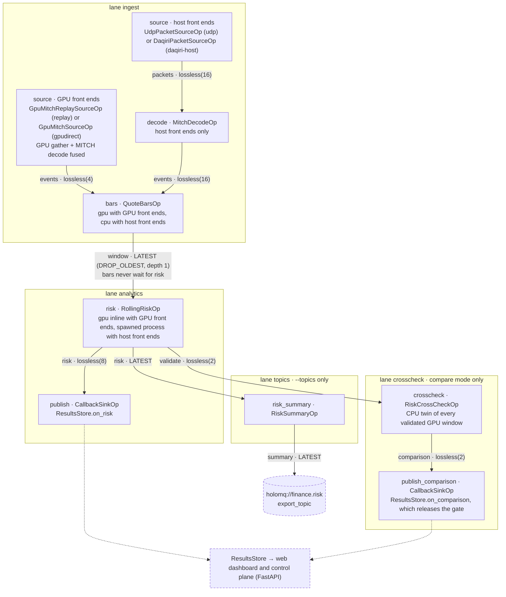

# equity_analytics

An example application of the Holoscan Module for Financial Services Industry: a live
equity dashboard on Holoscan SDK 5. The MITCH feed flows into five-second quote bars, then
rolling volatility, covariance and correlation on the GPU, then a web page. In the default
`compare` mode, a CPU worker recomputes every validated window alongside, so
each published GPU result has a matched CPU result.

The example is one plain composition of the module's operators
([`equity_analytics.py`](equity_analytics.py), with no operator classes of its own). Its
graph by lane, with the policy and depth of every edge; a run has one `source`, the GPU
row or the host row, chosen by `--ingest`:



Only the front end changes between ingest modes; every operator after it is shared:

| `--ingest` | Front end (lane `ingest`) | Bars | Risk (lane `analytics`) |
| --- | --- | --- | --- |
| `replay` | `GpuMitchReplaySourceOp`: pcap frames in GPU memory, GPU gather + MITCH decode, no NIC | `QuoteBarsOp(gpu)` | `RollingRiskOp(gpu, inline)` |
| `gpudirect` | `GpuMitchSourceOp`: DAQIRI GPUDirect into GPU memory, GPU gather + MITCH decode | `QuoteBarsOp(gpu)` | `RollingRiskOp(gpu, inline)` |
| `udp` | `UdpPacketSourceOp` (kernel socket) → `MitchDecodeOp` | `QuoteBarsOp(cpu)` | `RollingRiskOp(process)` |
| `daqiri-host` | `DaqiriPacketSourceOp` (DAQIRI into pinned host memory) → `MitchDecodeOp` | `QuoteBarsOp(cpu)` | `RollingRiskOp(process)` |

GPU front ends always run GPU analytics (`compare` or `gpu`), so market data never reaches
the CPU.

## Run

With the Holoscan CLI (`holoscan run equity_analytics <mode>`), on any GPU host:

| Mode | What it does |
| --- | --- |
| `replay` (default) | writes a synthetic day with `holoscan_finance.tools.synth`, replays it from GPU memory at 2,000 packets/s in a loop (each pass is a new generation), dashboard on port 8080 |
| `replay_pcap` | generates a full synthetic day under `synth-day/` and replays it once at 200,000 packets/s |
| `udp` | kernel UDP ingest with the CPU cross-check; start `python3 -m holoscan_finance.tools.replay_sender` separately |
| `udp_cpu` | kernel UDP ingest with CPU analytics only |
| `smoke` | CI: a small synthetic day, unpaced and headless; exits non-zero if the run fails, no window is analyzed or a comparison disagrees |
| `plan` | compiles and checks the plan rules only, and writes `equity_analytics.plan.json` |

`holoscan run` starts the container on the host network and the dashboard serves on the
default `--host 127.0.0.1`, so after `holoscan run equity_analytics replay` open
<http://localhost:8080/> on that host, or from another machine through an SSH tunnel
(`ssh -N -L 8080:127.0.0.1:8080 <host>`). The dashboard has no authentication and its `POST`
endpoints control the run: pass `--run-args "--host 0.0.0.0"` only on a trusted, isolated
network ([SECURITY.md](../../SECURITY.md)). Inside the dev container (`holoscan run-container`), add
`--local`. `GET /plan` returns the compiled lanes, edges and clocks, and `/snapshot`
carries them as `engine`. `GET /healthz` answers 200 once the ingest front end receives
(503 before, after a stop, and once a finite replay has played its last pass, while the
dashboard stays up and the body says `"input_ended": true`): start an external sender on
the 200, as `replay_sender` does.

For a headless, finite run directly from the repository root inside the Holoscan 5.0
image (`scripts/dev5.sh '<command>'`):

```bash
python3 -m holoscan_finance.tools.synth --out data/synth-small --symbols 500 --packets 50000 --seconds 1800 --reuse
python3 examples/equity_analytics/equity_analytics.py --ingest replay \
    --pcap data/synth-small/day.pcap --tape data/synth-small/tape --replay-pps 0 \
    --port 0 --exit-when-drained --report out/eq.json
```

`scripts/dev5.sh` publishes no ports and has no host network, and it kills the command
after `RUN5_TIMEOUT` seconds (1500 by default), so use it for headless runs only, not for
the dashboard.

**NIC modes are not in `metadata.json`.** `gpudirect` and `daqiri-host` need DAQIRI, a
ConnectX NIC, root and hugepages. They run only through
[`deploy/igx_thor/igx_run.sh`](../../deploy/igx_thor/README.md) (private IPC,
`--shm-size=4g`), never through `holoscan run`, which starts an image without DAQIRI and
always adds `--ipc=host`.

## Finite runs and exit codes

`--port 0` runs headless. With `--ingest replay --exit-when-drained` (and a finite
`--replay-loops`, 1 by default), the run stops as soon as every packet is decoded, every bar
built and the last window analyzed (and compared, in `compare` mode); nothing is in flight
at that point, so the stop loses nothing.
`--report PATH` writes the counters per stage, the receive-to-result latency percentiles
and the placement as JSON. `--expect-windows N` requires N analyzed windows (and, in
`compare` mode, at least one comparison and no disagreement).

| Exit | Meaning |
| --- | --- |
| 0 | ran and stopped cleanly |
| 1 | the run failed, timed out (`--timeout-s`) or left an error diagnostic |
| 2 | invalid flags |
| 3 | the plan was rejected by the compiler |
| 4 | the plan breaks one of the composition's rules |
| 5 | an `--expect-*` check failed |

## Holoscan 5 features shown

- Declarative operators with typed Params validated at `graph.op`, and live objects
  (stats, the feed directory, the cross-check gate) injected as `Ref` Params.
- Param-gated optional ports: `QuoteBarsOp.window`, `RollingRiskOp.validate`.
- `OnClock` sources with hold-and-retry on `BLOCKING` edges, and a lossless same-lane
  `OnEach` chain: no thread hop per packet.
- A `DROP_OLDEST`/1 latest-only edge from bars into an `OnClock(250 µs)` + `DrainAll` risk
  operator, so analysis runs on arrival at a bounded rate (the minimum update interval).
- Authored lanes with `ThreadPlacement`; `--ingest-cpus` and `--ingest-busy-poll` place
  the ingest lane, and no lane runs on the DAQIRI lcores.
- Plan rules checked on `plan.json()` before the run (`--plan-only`, `--plan-json`,
  `GET /plan`, `/snapshot.engine`).
- `run_async` under a FastAPI lifespan, with diagnostics surfaced in `/snapshot`.
- A deterministic finite run: a drained predicate, then `request_stop()`.
- `--risk-deadline-us`: a `max_start_delay` + `EMIT_WITNESS` count of late risk poll ticks.
- `--topics`: a compact risk summary exported to `holomq://finance.risk` over a latest-only
  edge, so a stalled reader never blocks the graph; subscribers find it in
  `--topics-catalog`.

The application imports the canonical package `holoscan_finance`, so a checkout runs with a
plain `PYTHONPATH=python`. With the wheel or the CMake staging installed, the same objects
are also importable under the module alias:

```python
from holoscan.finance.operators import QuoteBarsOp, RollingRiskOp
from holoscan.finance.operators.edges import LATEST, lossless
from holoscan.finance import Ref
```

## Data

The replay modes generate deterministic synthetic data automatically. For UDP modes,
generate a tape with `python3 -m holoscan_finance.tools.synth` and send it with
`python3 -m holoscan_finance.tools.replay_sender`; see the
[synthetic UDP instructions](../../README.md#synthetic-udp-replay).
Methodology: [docs/METHODOLOGY.md](../../docs/METHODOLOGY.md);
validation: [docs/VALIDATION.md](../../docs/VALIDATION.md).
